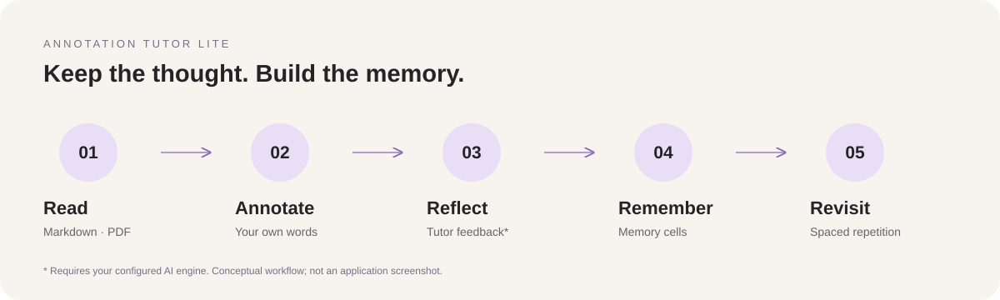

# Annotation Tutor Lite

> Current local source candidate: **0.7.8** (settings redesign dated 2026-10-23). It builds on the [0.7.7 recovery verification record](docs/project-recovery-2026-10-22.md); the [pre-recovery assessment](docs/project-assessment-2026-10-22.md) remains a historical snapshot. Source changes do not by themselves publish a release or update installed Vaults. Full commercial and desktop acceptance remain open; learning, check-ins and expert features are opt-in. [Usage and rollback](docs/tutor-learning-upgrade.md).


**Read closely. Think in the margins. Remember what matters.**

**English** · [简体中文](README.zh-CN.md)

An Obsidian desktop plugin connecting highlights, paper-like notes, and AI-assisted learning — in your own Markdown files.


*AI-generated editorial illustration, not an application screenshot.*

[Get started](#get-started) · [User guide](docs/guide.md) · [Changelog](CHANGELOG.md)

## Your understanding belongs beside the source

A highlight says “this matters.” A note says *why*.

Select a passage in Markdown or a text-based PDF, write your understanding, and return to it from the highlighted source. Move the note where it feels natural. Let its toolbar disappear when you're reading. When you want a second perspective, ask your configured tutor to review your thinking and help turn it into reusable learning memory.

No separate annotation database or mandatory hosted TutorLite account. Your notes remain readable, editable Markdown in your Vault. Saving annotations does not require AI; reviews, chat, and translation need an engine you configure.

## Reading and annotation features (since 0.2.4)

| What you read | What you can do |
| --- | --- |
| Markdown notes | Highlight passages and open draggable margin cards without leaving the note. |
| Markdown tables | Annotate cell text without inserting new block IDs into the source table; restore highlights in Live Preview and Reading view. |
| Text-based PDFs | Create annotations from selections, restore page highlights, reopen notes from the source, and follow page backlinks. |
| Every existing card skin | Hide action buttons at rest and reveal them on hover, with keyboard action focus and touch access retained. |

### A note, not another toolbar

Choose a clean, paper, sticky-note, leaf, or custom skin. All share the same quiet interaction: writing first, clear black icons when needed. Cards retain their identity through layout refreshes, improving the continuity of dragging and editing. Enable margin comments in settings to use draggable cards.

### PDF and Markdown, one highlight language

PDF annotations use the same color variables and style settings as Markdown. Their independent highlight layer avoids the PDF text layer's extra opacity reduction, and clicks are matched against the painted regions.

**The original PDF is not rewritten.** Annotations live in separate Markdown files, with backlinks to their captured pages.

## From a passage to a learning habit



1. **Read and annotate.** Capture the source and explain it in your own words.
2. **Reflect with your tutor.** Request feedback from your configured engine.
3. **Build learning memory.** Distill evidence-backed memory cells, group concepts into scenes, and maintain a learner profile.
4. **Come back to it.** Use SM-2 spaced repetition and generate a linked study notebook.

AI features are not an included model service or a guarantee of correct feedback.

## More than a highlighter

- **Settings workspace (0.7.8):** search across categories, configure connections in a list/detail view, and inspect each feature’s route. Editors retain drafts and focus through background refreshes. [Native settings preview and QA →](docs/settings-design-qa-2026-10-23.md)
- **Inspiration board:** draw over Markdown Live Preview, source mode, reading view, and PDFs; Markdown modes share the same board. Use the vertical tool rail for handwriting, text, and shapes. The board and sidebar share the model, API connection, and conversation; replies and drawings stream as they arrive. Closing the sidebar moves the latest reply into a temporary handwritten caption while preserving artwork. Includes uploaded and co-created sticker assets independent of the current Tutor character. [Board guide →](docs/inspiration-board.md)
- **Web capture:** the official [Obsidian Web Clipper](https://github.com/obsidianmd/obsidian-clipper) is the default cross-browser capture UI. Import Tutor's versioned template from **Settings → Annotation Tutor Lite → Web capture** so saved Markdown can be analyzed through either Direct API or OpenCode. The bundled Chromium extension remains an optional **Tutor Advanced Clipper** for in-page Tutor Q&A, per-highlight notes, and raw HTML snapshots. [Advanced extension setup →](extension/README.md)
- **Reading assistance:** inline glosses and whole-note pre-translation for supported Markdown workflows. PDF whole-document text extraction is not included.
- **Connected learning:** generated notebooks link back to annotations and source material; scenes and profiles retain context.
- **Four interface languages:** English, 简体中文, 繁體中文, 日本語.
- **File-based ownership:** annotations, reviews, memory cells, scenes, and profiles are plain Markdown. The index is a rebuildable cache.

## Get started

**Desktop only:** Obsidian 1.12.4+ on macOS, Windows, or Linux. Pad handwriting is a design direction, not a shipped mobile feature.

### Build the current source

This page describes local source candidate **0.7.8**. The remote Git branch may lag behind this workspace; check `manifest.json` and the checked-out commit after cloning. The latest GitHub Release may be older; check its version before installing. Development requires **Node 22.13+** and **pnpm 10**:

```bash
git clone https://github.com/Chain-Tang/AnnotationTutor.git
cd AnnotationTutor
pnpm install --frozen-lockfile
npm --prefix extension ci
pnpm typecheck
pnpm test
pnpm test:release
pnpm package
pnpm package:verify
pnpm install:vault -- --vault "/path/to/YourVault"
```

Run the final install command only for a chosen test Vault, using its absolute path. The default online installer currently uses the macOS Obsidian CLI: it verifies the release and credential compatibility, saves and stops the running plugin, backs up the installation, replaces it transactionally, then reloads and checks its version. Keep the printed backup path. A busy task or failed save blocks replacement.

For offline installation, fully exit Obsidian first and add `--offline`; then start Obsidian and verify loading manually. Offline success confirms filesystem checks only. Other platforms need offline installation or a separately validated host entry. Copying files alone does not reload a running instance. [Upgrade and recovery details →](docs/tutor-learning-upgrade.md)

### Install a packaged release

Open [Releases](https://github.com/Chain-Tang/AnnotationTutor/releases) and check the version and available assets. If a plugin ZIP is provided, extract it under your Vault's `.obsidian/plugins/` folder. For manual installation, copy the complete sealed plugin directory, including `main.js`, `desktop.js`, `mobile.js`, manifest, styles, credential compatibility metadata, offline fonts and licenses, into:

```text
<YourVault>/.obsidian/plugins/annotation-tutor-lite/
```

The full plugin ZIP and source installation scripts include runtime chunks, compatibility metadata, fonts and licenses. Copying only the three conventional plugin files is incomplete. Enable **Annotation Tutor Lite** in Community plugins settings after a manual install. For an existing installation, prefer the managed installer and its rollback path rather than overwriting live files. A third-party installer must preserve the complete sealed directory; use the full ZIP if it only retrieves conventional plugin files. Unpublished source changes are not available through a GitHub Release.

### Make your first annotation

1. Open a Markdown note or a PDF with selectable text.
2. Select a passage and run **Add learning annotation** with `Ctrl/Cmd + Shift + L`. PDF also offers a selection action and context-menu entry.
3. Write your understanding and save. Click its highlight to revisit it. Enable margin comments for draggable cards.
4. Move the pointer onto a card to reveal controls; move away to return to a writing-first view.

On first run, TutorLite creates its memory folder (default `Agent Memory/`) and, when enabled, an `AGENTS.md` describing the file protocol.

## Connect your tutor

Choose an engine in **Settings → Annotation Tutor Lite → AI connections**:

- **Direct API:** supply your own OpenAI-compatible endpoint, model, and API key. The current candidate uses system-encrypted credential storage outside the Vault; plugin configuration stores references. When secure storage is unavailable, new credentials are session-only. Historical configurations may still contain old plaintext.
- **OpenCode:** install and authenticate the CLI yourself, then select it as the engine. **Set up OpenCode** now validates the executable, model catalog, ACP handshake, selected model, and a minimal real model round-trip instead of reporting success from the catalog alone.

**Local-first is not the same as offline AI.** A configured remote engine may receive the text and context you send for review, chat, or translation. Provider privacy policies, retention, usage limits, and charges apply separately. Keep plugin configuration and credentials out of public repositories.

If Obsidian launched from the Dock or a desktop shortcut cannot find the CLI, set its full executable path in engine configuration. Common installation directories are searched automatically.

## Keyboard shortcuts

| Action | Windows / Linux | macOS |
| --- | --- | --- |
| Add learning annotation | `Ctrl + Shift + L` | `⌘ + Shift + L` |
| Translate selection | `Alt + T` | `⌘ + Shift + T` |
| Pre-translate whole note | `Ctrl + Alt + T` | `⌘ + Shift + Y` |

Rebind these in Obsidian's Hotkeys settings. macOS defaults avoid Option-letter combinations that can enter special characters. Other commands can be assigned shortcuts there too.

## Your learning memory, in ordinary files

```text
Agent Memory/
├── annotations/       # One Markdown file per annotation
├── memory-cells/      # Evidence-backed memories and review schedules
├── scenes/            # Related concepts in context
├── profiles/          # Learner profile and preferences
├── Notebook/          # Generated study notebook
├── proposals/         # Review queue in confirmation mode
└── AGENTS.md           # File protocol for external agents
```

Source quotes and your notes remain separate from agent reviews. Choose confirmation mode for proposed memory changes when you want to review them first. [Read the data model and guide →](docs/guide.md)

## Current boundaries

- PDF support depends on the viewer's text layer; scanned documents without selectable text need OCR elsewhere. Annotations are not exported as embedded PDF comments.
- PDF “bold” uses a heavier underline rather than modifying canvas-rendered glyphs.
- Repeated table text is matched by occurrence, not a complete semantic row/column identity. Unknown legacy anchor tokens are not automatically removed.
- Physical-pointer PDF workflows and real touch devices still need broader end-to-end validation. DOM regressions are not a substitute for every Obsidian version or theme.
- The desktop board implements handwriting and pressure-aware strokes. Mobile/Android device acceptance and the full physical-input matrix remain open; see the validation records.

## Develop and contribute

```bash
pnpm install --frozen-lockfile
npm --prefix extension ci
pnpm typecheck
pnpm test
pnpm test:release
pnpm package
pnpm package:verify
```

`pnpm dev` watches source changes; `pnpm build` builds plugin artifacts without packaging. `pnpm package` rebuilds the plugin and extension, then creates the sealed release folder and ZIP; `pnpm package:verify` checks that ZIP and writes `dist/package-verification.json`. Current recovery results and remaining gates belong in the [recovery record](docs/project-recovery-2026-10-22.md); older optimization reports describe their dated snapshots. CI checks types, tests, release transactions and packaging on Linux, Windows and macOS, with coverage on Linux. Remote results must be checked for the reviewed commit. Release from a reviewed branch/commit and distribute the complete ZIP; see [maintainer handoff](HANDOFF.md).

When reporting an interaction issue, include plugin/Obsidian versions, skin, view mode, reproduction steps, and whether the plugin was reloaded after installation. Prefer a non-sensitive sample document.

[User guide](docs/guide.md) · [Changelog](CHANGELOG.md) · [Table/PDF implementation notes](docs/table-and-pdf-anchoring.md) · [Pad design proposal](docs/pad-handwriting-spec.md) · [Next development: Pad & collaborative drawing](docs/next-development-plan.md)

## License

[MIT](LICENSE) · © 2026 Chain. Free to use, modify, and distribute under the license terms.
