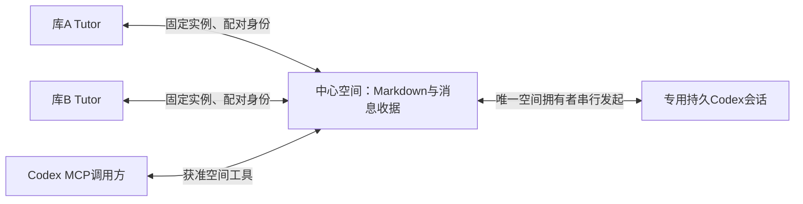

# 多库 Tutor 与 Codex 的双向协作

开发候选：Tutor 0.6.0 / Codex host plugin 0.5.0；日期：2026-10-17。

本次将[原实现审计](baseline-2026-10-16/implementation-audit.md)、[协作契约](baseline-2026-10-16/collaboration-contract.md)及[用户工作流](baseline-2026-10-16/user-workflow.md)从“所作”取回项目，保留为升级前基线。文件来源与哈希见[source-manifest.json](baseline-2026-10-16/source-manifest.json)。当前机制以本页和代码为准。

新实现让一个库保存协作空间，多个 Tutor 与一个专用持久 Codex 会话在其中收发请求、答复和更新。Tutor 可以发起请求，不需要先由 Codex 提问。各库保有自己的身份与资料；共享范围由空间成员和实际提供的材料决定。

## 如何使用

1. 在需要参与的库更新 Tutor。通过命令面板打开 **Tutor 协作空间**，或在 Tutor 设置中开启 **协作通信**。关闭协作通信会停止后台收发；Board MCP 是另一个入站工具服务开关。
2. 在作为中心的库新建空间，填写名称、目标和愿意共享的背景。这会创建本库 Markdown 记忆与对话文件。
3. 在中心空间点击 **建立专用 Codex 持久会话**。它建立独立的持久线程；后续请求恢复这个线程。它不接管当前桌面主聊天。
4. 如需其他库参与，两边都开启协作通信，中心库开启 Board MCP。在另一库的协作窗口选择中心库，点击 **配对并连接**；目标库会显示 Obsidian 配对窗口。可以只授权协作消息，不选学习文档。
5. 中心库在空间成员列表中明确加入刚配对的 Tutor。配对本身不会把它加入全部空间。另一库随后能看到获准空间。
6. 选择接收者并发送。给专用 Codex 或另一个 Tutor 的请求会进入持久收件箱。接收方在 Obsidian 打开、通信开启时处理，结果回写同一空间。结果消息不会自动再触发一轮回复。
7. 从 **打开共同记忆**、**打开对话记录** 查看文件。背景可手动修改；下一次请求会进行版本检查并纳入调用上下文。关闭窗口不停止已明确开启的通信；关闭通信或断开连接可停止对应后台工作。

设置中的 **协作中的 Tutor 回复** 可选择沿用现有 Tutor 配置，或使用现有 Codex 登录。后者为每个库的 Tutor、每个中心与空间保存独立的持久会话，和空间中的协调 Codex 会话分别保存。它只影响协作回复，不改变日常聊天与绘图配置；切换时会停止旧运行，再创建新运行。服务商拒绝访问、限流、模型未确认等失败会保留固定错误分类，不记录错误原文或自动重发。

Codex host plugin 更新后，需要刷新插件或新建聊天，才能使用新增工具；已有聊天不能假定工具已热加载。插件源目录升级与真实多库运行以本次[验证记录](verification-2026-10-17.md)为准。

## Markdown 与可靠投递各管什么

每个中心空间保存于：

```text
<memoryRoot>/communication/
  delivery-state.json                  # 结构化消息、身份和投递收据
  codex-bindings.json                  # 专用线程绑定；不含认证 token
  <spaceId>/context.md                 # 可编辑目标、背景、阶段摘要、来源版本
  <spaceId>/conversation.md            # 可阅读的公开对话与投递状态
```

库的稳定逻辑身份另存于插件 state，和发现时的路径标识分开。配对凭据经系统安全存储加密，保存在 Vault 外；Markdown 不保存 token。

协作 Tutor 选择 Codex 引擎时，其独立线程绑定保存在插件 state 的 `communication-tutor-bindings.json`，按本 Tutor 身份、中心和空间隔离。它与中心空间的 `codex-bindings.json` 分开，均不包含认证 token。

`context.md` 的正文包含“共同目标”“背景”“阶段摘要”，前置数据包含空间与版本、来源引用。编辑目标或摘要后，下次发送先将改动登记成新版本。旧版本或并发修改发生冲突时保留原文，不静默覆盖。

`conversation.md` 的自动区块根据消息收据生成，区块外可以写自己的笔记。它是对话材料，不是掌握程度、人格或信仰的自动判断。程序不会把在对话文件里写一个“completed”当成真实投递完成。

每轮明确带入空间目标、相关背景、阶段摘要、来源定位和有限的近期对话。超过上下文预算的内容会受限，不能声称已读取整个库。来源路径只是定位，不自动赋予读取或转发原文的权限。本次未增加全库向量检索或后台自动反思；已有研究及取舍见[Markdown 记忆参考](markdown-memory-references.md)。

## 通信与执行边界



- **多方向消息。** 请求、结果和更新包含发送者、接收者、空间、消息 ID、回复关系与上下文版本。发送者从配对身份派生，工具参数不能冒充另一个 Tutor。
- **权限。** 通信是独立权限，已有配对默认不开启。加入某空间不开放其他空间、其他笔记或学习记录。新增成员由中心库的本地界面管理。
- **固定路由。** Codex connector 的每次工具调用可指定 `instanceId`，不依赖并发可变的全局选库状态。库间 Peer 只连接已配对的固定本机端点，并核验身份。
- **主动 Codex 轮次。** 中心库拥有专用 App Server 线程；其他库投递到中心，由同一个拥有者串行处理，避免多个进程争抢同一线程。使用现有 Codex 登录，程序不读取认证文件。
- **取消与不确定结果。** `accepted` 是已保存，`processing` 是开始处理，`completed` 才是完成。未知结果不自动重发；重启也不重跑已进入 processing 的模型调用。
- **消息循环。** 自动消费者只回答 request；result/update 不触发另一轮。一个请求对每个接收者有独立状态。
- **容量。** 当前每空间最多256条消息、32个空间、32名成员，保留16个旧上下文版本；达到容量拒绝新增，不丢弃幂等键后偷偷重放。后续归档应保留消息身份与收据。

## MCP 工具

新增工具统一以 `tutor_communication_` 开头，除 identity 直接返回 host/caller，其余在 `structuredContent.value` 返回结果。

| 后缀 | 用途 |
| --- | --- |
| `identity` | 核验实际中心库及当前配对身份 |
| `spaces` | 只列出该身份获准的空间 |
| `create_space` | 创建明确目标、背景和成员的空间 |
| `read_space` | 读取共同背景与版本 |
| `update_context` | 按 expectedRevision 更新共同背景 |
| `send` | 向明确接收者发送消息；身份不由请求自报 |
| `mailbox` | 分页读取自己的收件箱或发件箱 |
| `transition` | 接收者推进自己的投递状态 |

`send` 的同一个 messageId 只可重放完全相同的消息；修改正文必须用新 ID。响应的 accepted 不等于模型已回答，也不等于学习者采纳结论。原 A2A 教学/绘图任务仍使用既有语义；新空间状态不能用旧任务 contextId 冒充。

## 代码与验证

主要模块：

- [通信核心](../../src/tutor-communication.ts)和[持久存储](../../src/tutor-communication-store.ts)
- [中心 Hub](../../src/tutor-communication-hub.ts)、[宿主控制器](../../src/tutor-communication-controller.ts)和[Obsidian 界面](../../src/tutor-communication-modal.ts)
- [MCP 工具](../../src/tutor-communication-mcp.ts)、[库间 Peer](../../src/tutor-communication-peer.ts)和[私有凭据](../../src/tutor-communication-credentials.ts)
- [持久 Codex 通道](../../src/tutor-codex-channel.ts)、[逐调用路由 connector](../../host-plugins/tutor/scripts/connector-source.mjs)
- [按 Tutor 与空间隔离的独立运行器](../../src/tutor-communication-runner.ts)

官方依据：[OpenAI App Server](https://learn.chatgpt.com/docs/app-server)支持显式线程创建、恢复和轮次调用。官方 [MCP Events](https://developers.openai.com/plugins/build/mcp-events)目前说明的主动事件入口面向 Work Cloud 等受支持场景；本次使用用户选定的专用持久 Codex 会话，没有假装为当前本地桌面聊天添加一个未经验证的唤醒接口。
