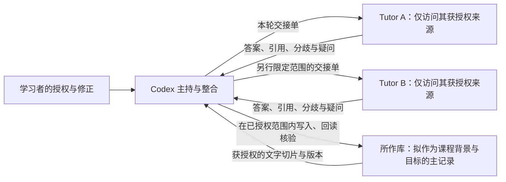

# 多库 Tutor × Codex：有范围的背景、目标与轮次交接契约

状态：**拟议应用层约定 v0.1；不是已实现的 API，也不是连接完成的证明。**

核查日期：2026-10-16（Asia/Shanghai）。实现证据见 [[通信实现核查]]。本分支未连接 Tutor、未配对、未访问真实 Vault、未写入用户记忆或修改配置。

## 1. 先用日常语言说明

可以把 Codex 看作这次课程的主持人，把各库里的 Tutor 看作熟悉各自获授权材料的助教。主持人每次发给助教一份小型“交接单”：学习者自己说过的背景、当前目标、这轮要做什么、可以看哪些材料、上一轮留下了哪些问题。助教交回答案、依据、分歧、疑问与下一步建议。

**传到了某段文字，不等于双方已经形成同样的理解；保存了任务结果，也不等于下一次模型调用会自动读到它。** 要使协作可靠，关键是把应当延续的公开信息写出来、注明版本，并在下一轮主动带上。

这里的“记忆”只指可查看和更正的背景、学习证据、项目状态及结论摘要。它不指模型权重、完整内部状态、未公开推理过程或自动共享的认知。模型应当给出可检验的理由和引用，无需交换隐藏思维链。

## 2. 三层各管什么

| 层次 | 用途 | 不应许诺的内容 |
| --- | --- | --- |
| MCP / A2A 协议 | 发现能力、传请求与结果、关联任务、查状态 | 自动合并各库、自动挑选正确记忆、建立共同理解 |
| 当前 Tutor 实现 | 配对授权、选库、读指定来源、独立推理、有限任务与结果保存 | 通用 `read_memory`、跨库共同记忆、普通教学任务无限续聊、任意笔记写回 |
| 本契约 | 约定身份、背景与目标的含义、来源、版本、共享范围、交接与更正 | 在未加代码的情况下自动校验、定时同步、撤回已传出的所有副本 |



图中的“所作”是课程保存库；主对话已确认目标路径。运行诊断没有发现可连接实例，图中的工具协作尚未实测；当前先用手动交接笔记。

## 3. 身份分开记录，不能互相冒充

| 身份 | 契约中的字段 | 当前实现如何对应 |
| --- | --- | --- |
| 逻辑 Vault | `vault_ref` | 人工维护的稳定逻辑标识，建议未来用 UUID；当前没有自动建立这个跨路径标识 |
| 发现实例 | `instance_id` | 当前为 Vault 绝对路径 SHA-256 的前 24 位；移动库后可能变化，不能用库名替代 |
| 当前运行 | `service_epoch` | 从发现记录的 `pid`、`startedAt` 和端点绑定；端口会变化，不是持久身份 |
| Tutor / 专家角色 | `agent_ref` | 必须包含所属库及角色；通用 Agent Card 名称 `Tutor` 不能区分多库 |
| 已配对调用方 | `client_id` | 服务器从配对 grant 固定；不是请求 JSON 自报一个 ID 就能获得权限 |
| 本课程协作会话 | `coordination_session_id` | 本契约自定义，主持人维护，不等于任何协议内建会话 |
| 本地聊天 | `tutor_conversation_id`、`chat_log_id` | Tutor 内部会话 UUID 与持久化聊天日志 ID 各自记录，未必相同 |
| Codex 聊天 / 临时专家 | `codex_thread_id`、`codex_turn_id` | 使用真正返回的 ID；反向临时专家不是当前桌面聊天 |
| 工作单元 | `local_task_id`、`remote_task_id` | 由相应任务服务返回；跨端要记录映射 |
| A2A 上下文 | `a2a_context_id` | 使用服务器返回值；当前 Tutor 将其设为单个 task ID，不应用自定义课程会话 ID 填进去 |

配对 token、API key、凭据文件内容不进入交接单或 Obsidian 教学文档。上述标识用于定位和审计，只有真实服务端授权才能赋予访问权。当前配对身份也不是按每个 Codex 聊天自动分开的用户身份，不能从 `client_id` 推断聊天隔离。

## 4. 最小共享范围

每次发出前，由主持人根据用户已有授权选取资料，未授权的传输不因这份示例而获得许可。用户已经授权的相同范围无需重复征求同意；只有新增来源、收件方、用途或写入范围才需要重新核对授权。

| 信息 | 这次课程可用的最小表达 | 保存与共享原则 |
| --- | --- | --- |
| 背景 | “学习者自述未受系统哲学训练，阅读《禅与摩托车维修艺术》后产生兴趣” | 标为用户自述，不能据此断言认知能力、人格或心理状态 |
| 目标 | 从古典到当代，跨东西方传统，以变化中的自我与同一性为线索 | 标明版本、优先级和仍待确认的范围 |
| 阅读偏好 | 实际说过的语言、难度、节奏偏好 | 未确认的偏好保持未知，不能把推荐方案写成用户偏好 |
| 学习证据 | 对指定段落的解释、提问与练习结果 | 自评、助教判断、可观察表现分开；一次理解不等于稳定掌握 |
| 轮次历史 | 已接受结论、材料范围、未解问题、下一步 | 简要摘要优先；避免搬运整段无关聊天 |
| 各库材料 | 只传相关片段及来源版本 | 能引用定位就不复制整库；从库 A 读到的资料，转发给 B 仍需满足转发授权 |
| 专家意见 | 有署名角色、来源和适用条件的结论 | 分歧保留，不通过多数投票把不同哲学立场压成统一答案 |

建议以“所作”中一份经核实的课程项目记录作为主记录。其他库保留索引或必要摘录即可；这属于组织方案；本套课程已提供可手动使用的背景笔记，不要求复制整个记忆目录，也没有开启自动同步。

## 5. 连接与授权核验后的工作流

1. **核实目标库。** 使用现有 `tutor_instances` 发现实例；有多个库时用准确 `instanceId` 连接。复用已有配对；只有权限范围要变时才重新配对。`tutor_status` 可核对 clientId/write/learningMemory，`tutor_list_documents` 与 `tutor_list_surfaces` 核对资料和目标范围。status 不返回 read/learningEvidence 或完整清单；学习证据授权应以配对设置及对应工具实际响应为准。不要仅凭“已安装技能”认定运行服务已经连接。
2. **准备一份小交接单。** 记录本轮的背景、目标版本、问题、允许来源、预计交付、未确定事项。当前 `tutor_start_task.prompt` 上限为 16000 字符；建议把核心交接单控制在约 6000 字符，为任务指令留空间。
3. **显式选来源。** 当前任务可带 `source`，服务端读取该来源开头最多 16000 字符。所需内容在文件后半段时，应先通过 `tutor_get_context` 按 `start/length` 读取并纳入精简交接单；不能假设 `source` 会加载整篇长文。`tutor_read_learning` 的结果也不会自动加入启动任务。
4. **发送并登记。** 每个新的逻辑任务使用新 key，记录返回的 task ID、所选实例、source 和交接单版本。同一次请求超时或结果未知时，先查询原任务；不能换 key 重提。还没有 task ID 时应保留原 key/messageId 与请求证据，先诊断而非盲目重复；去重受任务表保留范围限制，不保证跨重启。普通教学下一轮新建任务并带摘要；`tutor_supply_input` 只用于服务端正在等待输入的草稿，不是通用续聊 API。
5. **收回可检查结果。** 轮询 `tutor_task_status`，需要时读取进度。要求回复说明实际使用的来源、是否缺页或截断、哪些是事实、解释、建议、分歧或未知。收到失败不能补写一个想象中的专家回答。
6. **由主对话整合。** 主持人检查来源与版本，保留有意义的分歧，对需用户判断的事实或偏好列为待确认。知识性争议可并列观点，不必每个问题都让用户裁定。
7. **按已有写入授权落盘并回读。** 主对话用其获授权的文档操作方式更新目标笔记，记录实际路径与回读结果。Tutor MCP 没有通用 Markdown 文档写入或学习记忆写入工具；返回答案不能宣称已保存。

当前 connector 每次只有一个被选中的库。一个操作单元内完成“选库 → 读资料 → 发任务 → 取结果”，再切换下一库。不要交错依赖可变选库状态的调用。若未来需要同时连接，应为每个连接固定实例并增加结果归属校验；本分支没有部署这种改造。

## 6. 结构化交接单样例

以下 JSON **只是契约样例，未被当前 Tutor 自动解析或强制执行**。所有 `example`、`null` 和占位路径都应由真实核查结果替换后才可用于操作。可将精简 JSON 当作文字放在现有任务 `prompt` 内；目前 A2A 入站只接受 text parts，不能直接改成 `data` part。任意自定义 `metadata` 也不会自动变成 Tutor 的长期记忆。

```json
{
  "contract": "tutor-codex-context-capsule",
  "contract_version": "0.1",
  "example_only": true,
  "capsule_id": "example-philosophy-context-001",
  "revision": 1,
  "supersedes": null,
  "created_at": "2026-10-16T22:00:00+08:00",
  "identities": {
    "coordination_session_id": "example-philosophy-course-20261016",
    "origin": {
      "vault_ref": "example-vault-suozuo",
      "vault_display_name": "所作",
      "instance_id": null,
      "service_epoch": null,
      "agent_ref": "example-codex-course-host",
      "codex_thread_id": null
    },
    "recipient": {
      "vault_ref": "example-vault-study",
      "instance_id": null,
      "agent_ref": "example-tutor-reading-assistant",
      "implementation_version": null,
      "provider": null,
      "model": null
    },
    "connection": {
      "server_instance_id": null,
      "paired_caller_client_id": null,
      "mcp_protocol_negotiated": null,
      "a2a_protocol_negotiated": null
    },
    "protocol_bindings": {
      "local_task_id": null,
      "remote_task_id": null,
      "a2a_context_id": null,
      "tutor_conversation_id": null,
      "chat_log_id": null
    }
  },
  "authorization": {
    "state": "unbound-example",
    "grant_reference": null,
    "purpose": "协作设计哲学入门课程",
    "read_source_refs": ["user-brief-001"],
    "share_item_ids": ["background-001", "goal-001"],
    "recipient_agent_refs": ["example-tutor-reading-assistant"],
    "onward_sharing": "not-authorized-by-this-example",
    "write_scope": [],
    "expires_at": "2026-10-17T22:00:00+08:00",
    "revocation_ref": "example-grant-001"
  },
  "background": [
    {
      "id": "background-001",
      "statement": "学习者自述没有系统哲学训练，受《禅与摩托车维修艺术》启发。",
      "epistemic_status": "user_report",
      "source_ref": "user-brief-001",
      "valid_for": "course-design",
      "not_a_mastery_assessment": true
    }
  ],
  "goals": [
    {
      "id": "goal-001",
      "revision": 1,
      "status": "active",
      "owner": "learner",
      "statement": "建立从古典到当代、跨东西方传统的入门路线，以变化中的自我与同一性贯穿。",
      "deliverables": ["系统教学文档", "按难度分级且可查证的书目"],
      "success_criteria": ["能区分主要问题与立场", "能带着问题阅读原典"],
      "source_ref": "user-brief-001",
      "scope_not_yet_fixed": ["每周可投入时间", "实际使用版本", "课程总长度"]
    }
  ],
  "this_round": {
    "round_id": "example-round-001",
    "question": "提出一条适合初学者的自我与同一性问题线，并指出道家、佛教与西方讨论中不可直接等同的概念。",
    "allowed_actions": ["阅读已提供文字", "生成独立教学建议"],
    "requested_output": ["主要结论", "依据定位", "分歧", "未确定事项", "下一步"],
    "writing_to_memory": false
  },
  "previous_round": {
    "round_id": null,
    "accepted_conclusions": [],
    "open_questions": ["不把‘无我’直接译成‘没有任何经验主体’"],
    "summary_version": 1
  },
  "sources": [
    {
      "source_ref": "user-brief-001",
      "kind": "authorized-user-statement",
      "locator": "主对话中用户的课程需求；实际消息定位待主对话补齐",
      "revision": "example-user-brief-v1",
      "content_digest": null,
      "observed_at": "2026-10-16T22:00:00+08:00",
      "completeness": "selected-excerpt"
    }
  ],
  "ambiguities": [
    {
      "issue": "‘自我’可能指经验主体、人格同一性、叙事或修行中的执著。",
      "handling": "先区分用法，必要时并列解释，不擅自统一。"
    }
  ],
  "disagreements": [],
  "uncertainties": ["尚未核验真实 Vault 实例与资料授权"],
  "transport_notes": {
    "core_capsule_char_budget": 6000,
    "contains_full_transcript": false,
    "contains_hidden_reasoning": false,
    "if_truncated": "报告缺失内容，不声称已经阅读"
  }
}
```

来源还应支持 `vault_ref + relative_path + revision + range`、原著章页或官方网页 URL。路径标识的是出处，不能自动授予文件读取权。跨库重名笔记必须带所属库；版本不同的观点不要只按标题去重。`expires_at` 目前只是协作约定，既有配对不会据此自动到期，须由主持人停止使用或执行撤销。

## 7. 每轮回交样例

```json
{
  "contract": "tutor-codex-round-receipt",
  "contract_version": "0.1",
  "example_only": true,
  "round_id": "example-round-001",
  "received_capsule": {"capsule_id": "example-philosophy-context-001", "revision": 1},
  "actual_bindings": {"instance_id": null, "paired_caller_client_id": null, "task_id": null},
  "input_report": {
    "sources_used": ["user-brief-001"],
    "unavailable_sources": [],
    "truncation_observed": false,
    "scope_understood": "课程设计建议；不改记忆"
  },
  "conclusions": [
    {"id": "example-conclusion-001", "status": "proposal", "text": "先区分日常自我、人格连续性与修行中的我执。", "support": ["user-brief-001"], "support_type": "pedagogical-inference"}
  ],
  "disagreements": [],
  "uncertainties": ["哲学论断与推荐书目需附原著或学术来源后才能转为课程正文"],
  "learner_state_claims": [],
  "next_step": "核对原典与术语后，由主对话整合",
  "writeback": {"status": "not-written", "proposals": []}
}
```

“输入报告”是可核对的公开说明，不能证明模型内部真正理解了每个句子。主持人仍要检查回答是否与范围、资料和问题相符。没有真实返回值时保持 `null`，不伪造已连接凭据、任务 ID 或阅读回执。

## 8. 写回、幂等与撤销

**现有工具支持的幂等和本契约想要的幂等不是一回事。** 当前任务以客户端加 request key 在保留的任务表中去重；A2A 还临时检查 message ID 与内容；绘图提交有独立的版本和事务回执。这些机制不等于一般的背景记忆更新协议。特别是普通任务 request key 去重不检查 prompt 是否相同，改变内容必须使用新 key。

一般背景/目标写回应采用以下约定，第一阶段由主持人通过可查看的文档和人工记录执行；未来自动化需要另写实现与测试：

- 每次变更有唯一 `operation_id`、目标库及路径、`base_revision`、内容摘要和来源。相同 ID、相同内容返回同一回执；相同 ID、不同内容拒绝。
- 先生成候选差异，再检查当前文档版本；有并发变更则重新读取和合并。实际写入后回读校验，再报告 `written-and-verified`。文本已生成、请求已发送、任务 completed 都不代表完成写回。
- 用户自述的更正可以替换旧背景，但保留“被何版本取代”的记录。未经核验的模型推断保持 `proposal`，不悄悄变成用户事实或掌握程度。
- 撤销共享先停止新的读取、传输与任务，并撤销相应配对/授权；已落盘条目的更正或删除按具体范围执行，记录 tombstone 或取代关系。撤销不能让已发送内容从接收方或服务商的历史中自动消失。
- 撤销一个目标不应自动删掉独立来源中的原始学习材料。回滚某次写入时，只撤回该操作拥有的差异，遇到后续编辑则先比较，不覆盖用户新内容。

```json
{
  "contract": "tutor-codex-writeback-proposal",
  "contract_version": "0.1",
  "example_only": true,
  "operation_id": "example-write-001",
  "idempotency_key": "example-write-001",
  "status": "proposed-not-executed",
  "target": {"vault_ref": "example-vault-suozuo", "relative_path": "<verified-course-context-path>.md"},
  "base_revision": "<revision-read-before-write>",
  "source_receipts": ["example-round-001"],
  "change": {
    "kind": "append-round-summary",
    "claims": [{"text": "已完成术语区分草稿，原典核对仍待完成。", "status": "project-state"}],
    "payload_digest": "<digest-of-exact-change>"
  },
  "approval_reference": "<existing-user-authorization-with-matching-scope>",
  "expected_receipt": {"operation_id": "example-write-001", "new_revision": "<after-readback>", "verified": true},
  "undo": {"reverts_operation_id": "example-write-001", "requires_compare_to_current_revision": true}
}
```

## 9. 哪些事情不必等开发即可开始

现在即可在主对话已获授权的范围内编课程、维护一份小背景记录、逐库请教 Tutor、把出处与结果记入本轮摘要，再整合到“所作”。这依靠明确传入的文字与可检查的文件，不依赖自动共享认知。

若要升级到自动协作，仍需实现并验证：稳定跨迁移 Vault 身份、每次调用固定收件实例、结构化契约校验与版本协商、跨任务会话存储和上下文注入、跨库授权与转发限制、记忆写入及冲突控制、幂等回执、过期与撤销传播。即使这些全部实现，理解是否准确仍须通过解释、引用、练习和纠错来判断。

## 10. 协议与官方文档依据

- [A2A 1.0.0 规范](https://a2a-protocol.org/v1.0.0/specification/)：上下文关联、任务引用、文本/文件/结构化 parts 以及可选幂等；不定义本契约字段。
- [A2A 与 MCP 的分工](https://a2a-protocol.org/latest/topics/a2a-and-mcp/)：代理协作与工具/资源接入可以组合使用。
- [MCP 当前架构](https://modelcontextprotocol.io/specification/2026-07-28/architecture)：主机控制上下文聚合和跨服务器边界。
- [MCP 2025-11-25 架构](https://modelcontextprotocol.io/specification/2025-11-25/architecture)：与当前仓库 SDK 所用版本相对应；不能把新规范能力视为已升级。
- [OpenAI：MCP 配置与连接](https://learn.chatgpt.com/docs/extend/mcp?surface=cli)、[OpenAI：App Server](https://learn.chatgpt.com/docs/app-server)：连接配置、thread/turn 与显式继续会话的区别。配置共享不等于聊天或外部代理记忆自动共享。

本契约中的目录组织、字段、预算建议、单主记录和撤销流程是本次提出的设计，不是上述官方规范已经规定或当前 Tutor 已实现的能力。
