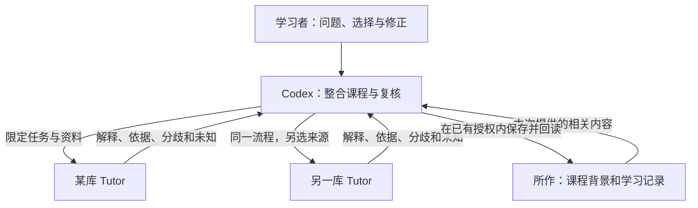

# 多个 Tutor 怎样与 Codex 共同教学

**A2A 足以作为通信的一部分，但协议本身不足以建立你需要的共同背景、长期目标和共享记忆。** 可靠的协作还要规定：谁参与，能看什么，本轮要解决什么，哪些结论延续到下一轮，谁负责保存，以及原文或目标变化后怎样纠正旧结论。

对这次哲学课程，可以由当前 Codex 主对话组织问题和整合，各库的 Tutor 围绕各自获授权的材料提供解释与复核，“所作”保存课程正文和可检查的学习记录。每个 Tutor 保留本库资料；需要合作时，带入相关片段及来源。这是一种可从手动交接开始的组织方式。

## 先确认这次真正做到哪一步

2026年10月16日，主对话实际调用 Tutor 诊断，得到 `Tutor unavailable: open Obsidian and enable Tutor MCP.`；实例发现返回 `instances: []`。这说明**本次未发现可连接的 Tutor MCP 实例**，尚未核验配对或资料授权。已安装并启用 Obsidian 插件，不等于已开启并连接它的 MCP 服务。

因此，这套课程是 Codex 分支研究、独立审校和主对话整合的成果。没有把一个未发生的 Tutor 回答算成专家意见，也没有建立自动跨库记忆网络。[[06_协作上下文]] 现在可作为手动背景笔记使用；工具连接后，再检验自动读取和教学调用。

## 协议、实现和协作约定分开理解

| 层次 | 提供什么 | 还需要什么 |
| --- | --- | --- |
| A2A | 代理之间的消息、任务、状态、产物及关联标识 | 应用决定保存哪些历史、怎样取回和注入模型、谁有权限访问 |
| MCP | 让 Codex 等宿主调用 Tutor 的工具、读取其暴露的资料 | 工具连接、文档授权、选库与本轮任务安排 |
| 当前 Tutor | 本地实例发现、配对、指定资料读取、独立教学任务和部分结果保存 | 完整的跨任务课程上下文、跨库共享与冲突处理仍须另做 |
| 本课程协作约定 | 共同目标、材料版本、轮次摘要、来源、分歧与下一步 | 手动执行即可起步；自动执行需要代码与运行验证 |

A2A 的 `contextId` 用来关联交互，`taskId` 标识工作；它们不是一段会自动进入所有模型的记忆。MCP 连接多个服务器，也不表示这些服务器互相看得到彼此资料或整个 Codex 聊天。依据：[A2A 1.0 规范](https://a2a-protocol.org/v1.0.0/specification/)、[A2A 与 MCP 的分工](https://a2a-protocol.org/latest/topics/a2a-and-mcp/)、[OpenAI MCP 文档](https://learn.chatgpt.com/docs/extend/mcp?surface=cli)。

## 现有项目支持什么

以下结论来自当前工作树的源码核查，表示实现能力，不能替代各库的运行验收。

**Codex 找某个库的 Tutor。** 本地 connector 发现实例，选中一个库，经 Obsidian 配对取得限定权限，再读资料、发教学任务、取结果。一个 connector 当前只有一个可变的选中实例。多库操作应完成“选库—读资料—发任务—收结果”后再切换，避免两项并行工作互相切走连接。实例身份由库路径派生；同名库不能只凭显示名称区别，移动库也可能改变发现标识。[connector 实现](/Users/mac/Tutor/host-plugins/tutor/scripts/connector-source.mjs:10)、[实例标识](/Users/mac/Tutor/src/tutor-discovery.ts:6)。

**Tutor 请 Codex 当专家。** 现有反向委派创建独立的临时 Codex 会话，传入这次指定的上下文，再收回文字结果。它没有进入我们正在使用的这个桌面聊天，也没有继承这里的全部历史。要继续本聊天，需要一条明确定位、授权和接续这个聊天的实现；当前 adapter 没有做这件事。[反向委派实现](/Users/mac/Tutor/src/tutor-codex.ts:56)、[OpenAI App Server 的会话机制](https://learn.chatgpt.com/docs/app-server)。

**A2A 的实际上下文。** 当前服务将 `contextId` 设为单个 `task.id`，返回的 `history` 是空列表。单独传入先前的 `contextId` 不会加载课程历史。普通已完成的教学任务，也不能靠任务 ID 继续闲聊；`tutor_supply_input` 只处理仍在等待输入的任务。继续学习通常要新开任务，并显式带上本轮背景和前轮摘要。任意自定义 metadata 也不会自动进入教学上下文。[A2A 适配器](/Users/mac/Tutor/src/tutor-a2a.ts:9)、[补充输入的条件](/Users/mac/Tutor/src/tutor-mcp.ts:198)。

**读取资料和学习记忆。** `tutor_get_context` 读取授权 Markdown 文字切片，可用 `start/length` 分段，每次最多16000字符；`tutor_read_learning` 另需学习记忆授权，只返回授权文档相关的批注和摘要。它不是一个通用的 `read_memory`，不包含所有聊天、所有长期记忆或别的库。任务启动也不会自动读入这些批注。长正文尤其要明确章节：目前启动任务读取所选来源开头最多16000字符。Codex 先读过后文，也不会自动让 Tutor 得到这些内容；需要把所需片段、来源与版本显式放入本轮 `prompt`，而 `prompt` 本身也限16000字符。一次 source 参数不能让 Tutor 读完本课程。[资料与学习工具](/Users/mac/Tutor/src/tutor-mcp.ts:135)、[宿主投影](/Users/mac/Tutor/src/main.ts:1623)。

**保存与下一轮输入。** 本地聊天日志、任务元数据和部分专家产物分别保存；它们不是同一个存储层。任务日志有 ID 和状态，不表示包含完整回答；有回答文件，也不表示下一轮必然读取；恢复一个聊天记录，更不等于恢复后端所有运行状态。返回“已完成”不能直接改写成“已写入学习记忆”。当前 Tutor 暴露的 MCP 工具没有通用的 Markdown 笔记写入工具。[聊天会话](/Users/mac/Tutor/src/tutor-conversation.ts:240)、[任务日志](/Users/mac/Tutor/src/tutor-journal.ts:8)、[专家结果存储](/Users/mac/Tutor/src/tutor-result-store.ts:7)。

## 将记忆分成三个可检查的层次

| 层次 | 本课程的例子 | 怎样延续 |
| --- | --- | --- |
| 各库本地资料与记忆 | 该库获授权的书摘、批注、学习证据 | 留在原库；需要时按来源和版本取相关部分 |
| 共同课程背景 | 学习目标、已读 Pirsig、当前单元、共享范围 | 使用 [[06_协作上下文]]；改变目标时更新版本或日期 |
| 本轮工作记忆 | 这次读的段落、你的复述、双方分歧、下一问题 | 对话末尾写短摘要；下一轮主动提供 |

这里“知道什么”应写成公开可核查的信息：用过哪些资料、哪条主张有何依据、对哪部分不确定、需要谁补充。它不要求交换模型未公开的内部推理，也不表示两个模型已形成完全相同的理解。

学习记录还须分清“我自己说理解了”“我实际完成了一项解释”“助手推测我掌握了”。一次回答或一条批注，不能自动成为长期掌握、人格或信仰的判断。[[05_我的学习记录]] 为实际证据留了位置，目前未替你填写学习成绩。

这张图是协作安排；当前发现不到实例，所以两条 Tutor 工具调用路径尚未在本次运行中验收。

## 一张交接单就能开始

下面是一份可直接复制到对话里的文字模板。它是背景信息，不是访问授权，也不是当前 Tutor 自动识别的特殊 API。

> 共同背景：我未受系统哲学训练，读过《禅与摩托车维修艺术》，正在学习“所作／哲学学习”的第X单元。 
> 本轮目标：我想解释［一个具体问题］，请先检查我自己的理解。 
> 我的解释：［自己的话］。 
> 可用材料：［库、文档、小节、版本或所附片段］。 
> 上轮结论与分歧：［有依据的简要摘要；没有就写尚无］。 
> 你的任务：［举例、重建论证、提出异议或核对原典，选一项］。 
> 返回内容：主要判断、原文定位、解释与事实的区分、未确定事项、下一步。 
> 保存方式：本轮先返回结果；是否更新长期学习记录，以我的选择及已有写入授权为准。

没有工具连接时，把这一张交接单和一小段材料带到另一个对话，再把答复带回来，也能开展有来源的交叉复核。无需先复制所有库。

有连接后，先确认实例与配对范围，读所需小节，再发送任务、登记任务 ID、收回结果。若任务状态未知，先查原任务，不要立即重发。普通下一轮用新任务并带摘要；不要把等待补充输入误当无限续聊。最终需要落盘的内容由有相应写入能力的主对话执行并回读确认。

## 如果要把它做成产品功能

可以在现有协议之上增加一个**课程协作空间**。这是后续开发建议，本次没有改代码或开通跨库访问。

1. **稳定身份与路由。** 分开记录逻辑库、实际实例、代理角色、课程空间、Codex 聊天和任务；不要用一个 `contextId` 冒充所有身份。每次返回附实际资料归属。
2. **版本化背景。** 保存目标、来源版本、已接受结论、未解分歧和下一步；每轮由程序明确挑选并注入，记录实际带入的内容与截断情况。
3. **来源与范围。** 每项摘要携带来源库、文档、位置、读取版本及可转发对象。读权限与转发、写入权限分开判断；用户已有授权可以复用，新增范围另行确认。
4. **结果与写回。** 区分“助手建议”“用户采用”“已实际保存”；写回有版本检查、冲突提示和回读凭据。相同任务重试不重复新增记录。
5. **更正与遗忘。** 原文更新后标记相关摘要待复核；撤销后停止后续访问。取消任务、删除本地摘要和接收方清除已收到副本是不同操作，分别报告实际结果。

最先值得实现的是“可查看的共享背景＋每轮摘要交接＋真实来源记录”，随后再做多连接并行与自动同步。这样每一步都能用一次具体学习任务验收，而不是只检查两个代理是否互相发过消息。

## 进一步核查的入口

本说明依据2026年10月16日工作树；源码行号会随升级变化。详细材料保存在“技术附录”的 [[通信实现核查]] 和 [[协作契约草案]] 中，供开发时回查，学习哲学不需要先读完。

官方规范与产品机制可查：[A2A 固定版规范](https://a2a-protocol.org/v1.0.0/specification/)、[MCP 架构](https://modelcontextprotocol.io/specification/2026-07-28/architecture)、[OpenAI MCP](https://learn.chatgpt.com/docs/extend/mcp?surface=cli)、[OpenAI 会话状态](https://developers.openai.com/api/docs/guides/conversation-state)。协议支持某机制、项目已实现该机制、本次已经验收，始终是三种不同结论。
