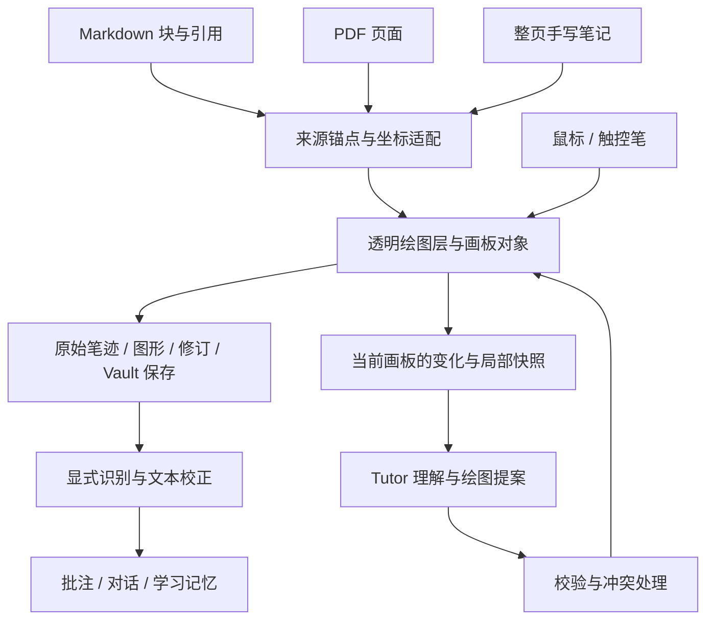

# Tutor 继续开发：Pad 手写与灵感画板

> 日期：2026-09-11  
> 状态：产品方向已记录；以下架构、默认交互与里程碑为实施提案，尚未交付。  
> 本文是后续开发入口，与 [Pad 手写规格](pad-handwriting-spec.md) 配合阅读。

## 1. 这次确定的方向

Tutor 接下来围绕两个方向发展：**支持手写识别的 Pad 端**，以及**人和 Tutor 一起作画的灵感画板**。画板覆盖在 PDF 或 Markdown 内容之上，Agent 能持续了解当前画板变化，在同一片空间里解释、标记、接画和回应。

希望带来的体验是：学生读书、写想法、随手画，Tutor 看懂当前上下文后接上一笔。它既能画教学示意，也能画简单表情和小涂鸦，让学习过程有趣、有回应，让学生愿意亲近和创作自己的 Tutor 形象。

用户提到的 DeepSeek 同人图与表情包作为产品灵感记录；本文不将其流行原因或用户群规模当作已验证研究结论。用户进一步明确：形象可以由我们制定、由用户上传，也可以由用户与 Tutor 一起完成；极简风和固定原创角色都可支持。具体外形、名字、配色保持可选择，不锁定单一吉祥物。

两条路线共用笔迹、图形、锚点、存储和 Agent 协议。Pad 增加笔输入与识别适配；灵感画板增加共同作画和可爱表达。既有学习闭环继续承接经过确认的学习内容。

## 2. 仓库现状与旧文档的关系

以下现状按本次工作区代码核验，不照抄历史路线图中的“尚未实现”。

| 部分 | 现有依据 | 对继续开发的意义 |
| --- | --- | --- |
| 桌面插件 | [manifest.json](../manifest.json)，版本 0.2.4，`isDesktopOnly: true` | Pad 尚未交付；需要移动依赖隔离和真机验证 |
| Pad 设计 | [pad-handwriting-spec.md](pad-handwriting-spec.md) | 已规划 Android → iPad、原墨与识别文本双层、整页手写、双击识别、可选原生 companion；不是现有实现 |
| Markdown 锚定 | [model.ts](../src/model.ts)、[anchors.ts](../src/anchors.ts) | 可复用块 ID、引用与修复思路；还需笔迹的局部坐标和空间关系 |
| PDF 覆盖与旁注 | [pdf-highlighter.ts](../src/pdf-highlighter.ts)、[pdf-rail.ts](../src/pdf-rail.ts)、[pdf-annotation.ts](../src/pdf-annotation.ts) | 已有页级透明高亮层、页码、连线和卡片；尚无手写与共画 |
| 文件与对话 | [store.ts](../src/store.ts)、[model.ts](../src/model.ts) | 已有 Vault 存储、批注对话、自写事件保护；还需画板对象与修订协议 |
| Agent 通道 | [api-runner.ts](../src/api-runner.ts)、[acp-session.ts](../src/acp-session.ts) | 当前消息输入以文本为主；需新增画板上下文、能力协商和绘图结果处理 |
| Excalidraw | [builtin-commands.ts](../src/builtin-commands.ts)、[excalidraw-guard.ts](../src/excalidraw-guard.ts) | 已有独立绘图笔记生成与格式辅助；可保留互通，不作为原文共画的必需前置 |

[改进方案](improvement-proposal.md) 与 [表格/PDF 笔记](table-and-pdf-anchoring.md) 包含历史快照，其中部分缺口已经补齐。当前功能状态以代码为准；后续两方向范围以本文为入口。

旧 Pad 首版排除 PDF、实时协作和贴纸，是当时的交付范围。这次将它们纳入整体路线，分阶段交付；不要求一次 Pad 首发完成整个画板愿景。单机的一位学生与一个 Tutor 共画是第一目标，多人联网白板另行规划。

## 3. 共用底层



透明 canvas 承载可见笔迹。产品能否可靠使用，还取决于内容重排后的定位、双方操作的归属、Agent 看到了哪个版本，以及重开后能否恢复。首版可用 Canvas 2D 绘制交互笔迹、派生 SVG 提供便携显示，文本与操作控件使用 DOM；具体渲染实现不进入持久化协议。

### 3.1 三种来源、三种坐标规则

| 来源 | 持久化定位 | 显示变化的处理 |
| --- | --- | --- |
| Markdown 阅读内容 | 来源路径、可用的块 ID、引用/上下文、块内局部坐标、独立边注位置 | 字号、分栏、段落变化后重新定位；失败则保留笔迹并提示重新关联 |
| PDF | 来源身份与版本、页码、未旋转页面坐标、页面尺寸与裁切信息；有文字时另存引用 | 页面缩放、旋转、重新挂载时进行坐标变换，不能把视口像素当作永久位置 |
| 整页手写笔记 | 笔记身份、稳定页 ID、固定纸面坐标 | 旋转窗口只缩放或平移纸面，不重新排布原有笔迹 |

Markdown 中，原始点列保持不变；划线和圈注可以基于当前文字位置派生显示，整段手写与小图作为一个对象移动。不要为迁就重排而把学生画的脸拉伸变形。窄屏空间不足时进入锚定段落后的书写区。

PDF.js 的 viewport 带有缩放和旋转信息，官方示例也区分显示尺寸与设备像素尺寸；据此，PDF 适配器应集中管理正反坐标变换。Obsidian 能暴露哪些页面接口仍须验证，不能直接假设可访问示例中的所有对象。[PDF.js 官方示例](https://mozilla.github.io/pdf.js/examples/)

覆盖层按当前页面或可见块挂载，阅读模式保留原生选字、滚动和批注点击；书写模式接管绘图输入。首个 Markdown 切片针对阅读视图，Live Preview 和源码编辑下的输入仲裁后续单独验收。

### 3.2 输入与原墨

沿用 Pad 规格：笔尖书写、手指导航、可配置擦除、套索选择；不支持压力或侧键时仍能画基本线条。Pointer Events 提供统一指针类型及压力、倾斜等属性；采用这些能力属于实现选择，具体设备的信号质量和掌触表现必须在 Obsidian 内实测。[W3C Pointer Events](https://www.w3.org/TR/pointerevents3/)

学生落笔在本地立即显示与保存，不等待识别或模型响应。预测笔迹如用于降低视觉延迟，只能作为临时显示，不能写成原始点列。`pointercancel`、切换页面、手指滚动和应用切后台都要结束或恢复当前笔迹事务。

### 3.3 文件与对象归属

建议扩展原 Pad sidecar 方案：

```text
Agent Memory/
├── annotations/ANN-....md        # 批注、已确认文字、对话
├── ink/INK-....ink.json          # 原始点列与识别来源
├── ink/INK-....svg               # 原墨的派生预览
└── boards/
    ├── BOARD-....md             # 人可读入口、来源、预览与说明
    ├── BOARD-....board.json     # 对象、关系、变换与画板修订
    └── BOARD-....svg            # 当前画板的派生预览
```

Markdown 保持笔记和学习语义入口；原墨 JSON 保存可编辑笔迹，画板 JSON 保存空间状态。SVG 都可重新生成。上述新增格式尚未发布，不能宣称当前 Markdown 解析器已支持它们。

- 使用独立的 `BoardDocument`，避免与现有学习组织单元 `Scene` 混淆；画板可关联批注或 Scene。
- 原墨沿用 Pad 的稳定 `strokeId`；画板自由笔迹对象引用 `inkId/strokeIds`，不另存一份竞争的点列。
- 对象记录 `id`、`createdBy: human | tutor`、`objectRevision`、来源锚点、局部变换、分组及可见性。后续编辑者与原作者分别保存。
- 识别结果绑定参与识别的笔迹 ID 和版本；学生继续写后，旧结果不能冒充最新转录。人工校正保留原墨和识别来源。
- AI 的一次完整动作作为一个撤销单位。学生可以移动、修改、删除或接画 AI 对象；学生改动后，旧 AI 请求失去修改该对象的资格。
- 新 schema 独立版本化，旧批注仍可打开。实现前将 Pad 草稿中的未发布示例映射到新格式；若已有试验数据，提供显式导入与备份。
- 资产先写入并校验，再更新画板清单；保留上一个有效修订，导出失败可重建。跨文件写入不能被当作天然原子事务。
- 同一设备由画板控制器串行提交。Vault 同步后的外部修改按基准版本检测冲突并保留双方副本，不宣称文件同步已经提供实时多人协作。

## 4. Agent 如何实时参与

### 4.1 协作会话

常规手写沿用原文档的本地默认行为。用户开启当前画板的 **一起画** 后，Tutor 持续接收这次会话范围内的变化，并可直接添画；无需每一笔重新确认。入口说明当前模型会接收哪些文字和画面，画板保持一个轻量的协作状态提示。

用户可以随时暂停。暂停、关闭画板或切换文档后停止为 Agent 采集和提交上下文，使旧请求结果失效；重新开启才继续。本地书写和保存仍然可用，会话不自动跟随到其它笔记。局部截图在模型支持且本次会话启用图像上下文时使用，范围限当前选区或可见画板。

这里区分三个动作：本地保存笔迹、向当前共画会话提供上下文、把某段理解写入长期学习记忆。共画产生的小表情不会自动成为记忆单元，识别猜测也不会自动覆盖学生的已确认笔记。

### 4.2 观察的内容与节奏

本地控制器持续监听笔画完成、对象移动/删除、选区变化和来源重排。模型获得：

1. 当前画板与来源的修订号、选区和可用作画区域。
2. 自上次处理以来的人类操作、对象关系、附近原文与已有确认文本。
3. 必要时的局部渲染快照，包括底层原文与上层笔迹，并附快照到画板坐标的变换。
4. 本次协作目标，例如“接着这张草图画”“帮我理解这个过程”“轻量回应”。

以笔画组完成后的短暂停顿触发合并处理。初始试验参数可取停笔约 1 秒、自动请求间隔至少 3 秒、同画板最多 1 个在途请求；这些是可调参数，不是已经达到的延迟指标。学生明确提问可立即调度。

请求期间的新变化合并为下一份增量；用户连续书写时优先保持书写流畅。无变化不重复请求，Tutor 自己的绘图不触发新的自动回应，失败后采用有限重试。自动表情单独设置更长冷却与“安静 / 适中 / 活泼”偏好，不能每写一个词就插话。

### 4.3 理解画板与生成绘图分开实现

当前 Direct API 的 `ChatMessage.content` 为字符串，ACP prompt 也以文本发送。第一步可以让模型读取已确认文字与简单图形对象，再返回结构化绘图操作。任意手绘内容的视觉理解需要新增图像消息和模型能力检测；没有视觉能力时清楚说明可理解的范围，不把“收到了坐标 JSON”当作已经看懂学生的画。

两种引擎最终归一为同一个 `BoardAgent` 契约：输入有界上下文，输出绘图动作。Direct API 可先解析严格 JSON 文本响应；支持工具调用的引擎可映射成同等动作。MCP 或 OpenCode 扩展是适配路径，不是 Pad 共画的必要条件。

首批动作建议为线条/路径、箭头、基础几何形、短文字和已登记表情组件。后续支持更自由的路径与图片资产。模型无需返回 JavaScript，也不直接操作 PDF.js、DOM 或任意 Vault 文件。

### 4.4 绘图操作与过期处理

每个响应包至少包含以下字段；此处是契约草案，不是已实现类型：

| 字段 | 用途 |
| --- | --- |
| `schemaVersion`、`boardId`、`sessionId`、`requestId` | 确定协议、目标和会话，去重响应 |
| `baseBoardRevision`、`sourceRevision` | 标明模型看到的画板和原文版本 |
| `operations` | 有限的 `add`、`update`、`remove` 操作；包含对象 ID、几何和分组；作者由宿主确定 |
| `expectedObjectRevision` | 更新或删除时必填，防止覆盖后来的编辑 |
| `description` | 对整组绘图的文字说明，用于可访问阅读与历史查看 |

首版采取保守策略：响应基准过期则舍弃并以最新上下文重新规划，不自动合并到不确定的位置。之后可优化为只重算受影响对象。

插件校验对象 schema、有限数值、点数/尺寸上限、允许绘制区域、资产引用和所有权。操作身份由宿主依据会话赋予，AI 新建对象标为 `createdBy: tutor`，不能信任模型自报人类身份；编辑现有对象时保留原作者并记录编辑者。原始 SVG/HTML 不能未经处理直接注入页面。Tutor 默认只新增自己的对象；需要改学生的笔迹时先提供可预览的改动，学生明确要求改该区域后才应用。

合法操作整组提交并保存，再按路径顺序显示“正在画”的过程；逐笔呈现是渲染动画，不要求模型每个坐标都进行一次网络调用。动画可关闭或中止；撤销整组后迟到的动画与响应不能让图形重新出现。

## 5. Pad 手写识别如何接入

沿用已有 Android → iPad 顺序、原墨优先、中英混写目标与 provider 接口。后台先分组和保存；笔尖双击或明确识别操作才启动识别。旧文档的“逐步识别”按这个显式触发规则解释。

手写文字、公式和示意图分别保留语义状态，无法识别的图形仍完整可见。文字识别成功不等于数学推导或整张图已理解。

ML Kit 的 Digital Ink Recognition 接收笔迹而非页面截图，可在设备端识别，适合作为既有 native companion 候选；这不能证明 Obsidian 插件已经能调用它。是否需要 companion、桥接方式和目标语言质量由真机试验决定。[ML Kit 官方说明](https://developers.google.com/ml-kit/vision/digital-ink-recognition)

原 Pad 决策日志已允许开源 native companion，不重复把“是否允许 companion”设为门禁。识别引擎本身是否必须开源、具体平台最低版本等未定事项保留；旧文档中的 iPadOS/API 版本声明在实施前重新查证并实测。

移动化还需隔离 `main.ts`、`agent-runner.ts`、`acp-session.ts`、`web-bridge/server.ts` 等桌面 Node/进程/HTTP 依赖，以及 `process.platform` 与 Node 加密调用。先建立可在移动端加载的入口与平台适配，再修改发布清单中的移动支持声明。

## 6. Tutor 的可爱来自具体回应

角色应温柔、好奇，能认真解释，也能接住学生随手画出的东西。表情围绕当前学习活动发生，用具体观察表达关注。学生可以决定活跃程度、随时擦掉小画或关闭陪画。

| 学习中的瞬间 | Tutor 可以怎么画 | 可以怎么说 |
| --- | --- | --- |
| 学生修正了一个推导步骤 | 在修正处旁边画一面小旗 | “这一步把条件补齐了。” |
| 学生说“这里卡住了” | 小角色搬来一块垫脚石，指向下一步 | “先看这一小步，我们把它拆开。” |
| 学生画了一个歪歪的细胞 | 保留线条，在旁边接出标签和一个认真观察的小脸 | “我在旁边标一下，你继续画。” |
| 两个概念容易混淆 | 画两只各举一个关键词的小角色 | 用一句话点明区别 |
| 学生完成一段阅读 | 页边出现一颗小芽或伸懒腰的小角色 | 简短回应，允许安静停留 |
| 学生只想随手涂鸦 | 顺着已有一笔接成小故事 | 跟随学生选择，允许这次只是画画 |

### 6.1 形象来自我们、用户或双方共创

| 来源 | 入口与体验 | 保存方式 |
| --- | --- | --- |
| 我们提供 | 从预设中选用极简涂鸦或固定原创角色，随时可换 | 版本化角色包：基础形象、可辨认特征、配色、表情组件与说明 |
| 用户上传 | 上传喜欢的角色图作为自己的 Tutor 形象，预览后使用 | 保留原文件，另存显示尺寸、裁切与形象描述；上传本身不要求立即生成新图 |
| 与 Tutor 共创 | 在画板上画、修改和接画，选中满意的组合后“存为 Tutor 形象” | 保存选中对象/资产、共同创作来源和参考图，可继续编辑并形成新版本 |

极简风与固定原创角色是表现选择，三种来源都可以采用。更换角色不更换学生的学习记录、Tutor 的教学能力或共画协议。

提出独立的 `TutorCharacterProfile`，至少包含 `id`、`version`、`origin: builtin | uploaded | co_created`、名字、风格说明、基础资产引用、表情/动作映射与文字描述。画板上的角色对象引用具体形象版本，换装或修改形象后，历史画板不会全部悄悄变脸。数据与资产建议放在 `Agent Memory/characters/`，不把内置角色硬编码进绘图动作。

上传的位图先作为可移动图片对象或贴纸显示，保留原图，不强求自动矢量化。新增表情可使用独立矢量配件，或由支持参考图的图像生成能力衍生；没有这类能力时保留基础形象与可用动作，并如实展示能力范围。衍生图保留所用参考与形象版本，用户可选满意的结果加入角色包。

### 6.2 稳定形象，灵活回应

初始探索可以包含思考、疑惑、发现、加油、小小庆祝、安静陪读六种表情。每套形象保留可辨认的特征，让学生也能画；动作和构图随上下文组合，而非每次随机换成不同角色。表情与色彩之外提供文字说明，反馈不只靠颜色区分。

表现语气保持自然：讲错时承认并修正，鼓励时指出实际进步；学生离开或关闭功能时平静结束。与学习有关的能力判断来自作品和对话，不凭涂鸦推断心理状态。

共创能力逐步开放：学生可给 Tutor 添眼镜、改表情、起昵称，把双方的一组涂鸦存为个人贴纸或新的 Tutor 形象。导出默认只含选中的角色组，提供透明 PNG，以及适用时的 SVG 与简单说明；位图型角色不会因导出 SVG 自动变成矢量。带上原文或学习内容由学生选择。同人创作的空间来自角色容易再创作、工具便于分享，是否形成社区需在实际使用中观察。

动态小反应用矢量组件与路径生成即可起步；复杂插画可作为之后的独立能力，按需生成后成为画板中的一个可移动对象。角色形象与生成路线都不应阻塞基础共画验证。

## 7. 建议推进顺序

| 阶段 | 可交付结果 | 完成依据 |
| --- | --- | --- |
| 共同基础 + Android 能力试验 | 笔迹/对象/锚点协议、持久化与撤销；并行检测移动加载、真实笔输入、同笔迹识别路径 | schema 与恢复用例明确；真机报告区分已支持和待解决能力 |
| Markdown 共画首个闭环 | 阅读视图的一块有限区域内，人画 → Tutor 理解局部上下文 → 添加简单示意/表情 → 撤销 → 重开 | 在真实 Obsidian 操作成功；至少一个视觉模型能回应手绘内容，纯文本模式如实降级 |
| Android 手写 MVP 与 PDF 画板并行 | Android 跑通原墨、显式识别、校正、提交；PDF 接入同一绘图与 Agent 协议 | 原 Pad 验收项仍适用；PDF 缩放/旋转/滚动后笔迹与对象定位正确 |
| iPad 与体验完善 | Pencil 输入及识别适配，更多图示/接画，预设/上传/共创角色、个人表情与导出，补齐其它 Markdown 视图 | 真机验证、跨设备重开、长会话和冲突恢复通过 |

**推荐下一项实际开发：** `Markdown 阅读视图共画纵向切片`，并行开展 Android 设备能力试验。用一条完整体验验证共享底层，不以完成全部移动识别为前置。

这个切片至少包含：创建/打开画板、画笔/橡皮/撤销、本地持久化、一起画/暂停、局部上下文、结构化 AI 图形、可选视觉输入与能力提示、Tutor 动作的成组撤销。不将只会画固定表情的演示宣称为已实现手绘理解。

## 8. 验收重点

1. 笔迹即画即显；断网和模型失败时仍可书写、擦除、保存与重开。
2. 原墨、机器识别与人工校正相互可追溯，识别不删除或替换原墨。
3. Markdown 重排、PDF 缩放/旋转、页面卸载后重挂载不会静默错位；无法定位时可找回笔迹。
4. 学生持续画时不会被模型阻塞；关闭或暂停后不再为 Agent 采集或提交上下文，本地书写保存仍可用，迟到回应不会落到别的页上。
5. 重复响应幂等、过期响应拒绝；AI 不能覆盖学生刚修改的对象。
6. 一次 Tutor 作画可完整撤销，撤销后的动画不会复活；重开保留最终状态。
7. 非法绘图包被拒绝且不破坏已有画板；损坏或部分落盘可恢复到有效修订。
8. 纯文本模型和视觉模型的可用能力在实际样例中分别验证；图像输入范围与会话状态一致。
9. Android/iPad 真机分别验证笔尖、掌触、滚动、分屏、旋转与实际识别质量，桌面模拟不能替代。
10. 预设、上传和共创形象均可选择、保存与重开；更换形象不重写历史画板，缺少图片生成能力时仍可使用上传角色。
11. 学生能理解 Tutor 在回应哪一步，觉得可关闭、可改画；收集“帮助理解 / 打扰 / 想保留这张小画”的反馈，不把使用时长当作唯一成功指标。

测试策略：纯逻辑重点覆盖坐标变换、序列化、版本冲突、撤销和响应校验；DOM 集成覆盖挂载/卸载与输入仲裁；真机验证书写体验与平台能力。本文只是文档更新，尚未执行这些功能验收。

## 9. 决策与文档衔接

| 日期 | 记录 | 状态 |
| --- | --- | --- |
| 2026-09-11 | 继续开发以 Pad 手写识别、灵感画板为两条主要方向 | 用户方向 |
| 2026-09-11 | PDF/Markdown 上的透明绘图层支持人机协作与 Agent 持续观察 | 用户方向，扩展旧 Pad MVP 总体范围 |
| 2026-09-11 | Tutor 能画简单表情和涂鸦，发展亲切、可再创作的形象 | 用户方向 |
| 2026-09-11 | 形象支持我们制定、用户上传、双方共创；极简风与固定原创角色都可采用 | 用户补充确认；具体形象待探索 |
| 2026-09-11 | 共用数据与工具协议，以显式开启的共画会话衔接旧本地默认规则 | 本文实施提案 |
| 2026-09-11 | 优先验证 Markdown 共画闭环，Android 设备试验并行 | 本文实施建议，不代表已发布排期 |

后续实现保持 [Pad 规格](pad-handwriting-spec.md) 中与本文不冲突的要求，尤其是原墨保留、整页手写、Android → iPad、确认后的学习语义与真机能力验证。历史“自动逐步识别”按较晚的显式识别决策执行；开启共画会话属于新增交互，普通手写不因此自动送 Agent。
