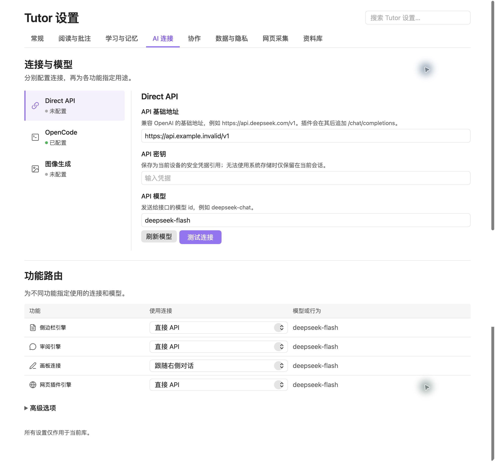

# Tutor 0.7.8 settings design QA — 2026-10-23

final result: passed

**Findings**

No actionable P0/P1/P2 findings remain in the tested settings workspace. The selected third direction is implemented in the production plugin: horizontal categories and search, a connection list with a wide detail editor, and a compact independent routing table. This is a native Obsidian implementation rather than a static mockup.

**Evidence and normalization**

- Source visual truth: `docs/assets/settings-0.7.8/selected-design.png` (1487 × 1058 pixels; generated visual reference, no physical CSS viewport).
- Latest native implementation: `docs/assets/settings-0.7.8/native-light-top.png` and `native-light-routes.png`, captured from Obsidian 1.14.4 in the synthetic `Tutor-Settings-QA-20261023` vault, plugin 0.7.8.
- Native viewport: 1470 × 836 CSS px, device pixel ratio 2; each raw capture is 2940 × 1672 pixels. The app-owned settings panel starts at (250, 30) CSS px and measures 1220 × 806. The content column is capped at 1100 CSS px.
- Full comparison: `docs/assets/settings-0.7.8/comparison-full.png` (2230 × 1145). Both source and implementation were opened together in this comparison input. Source crop: (358, 62)–(1458, 1038), 1100 px wide. Native captures are downsampled 2:1 and cropped to the same 1100 px content width. The overview stitches two real scroll captures at scrollTop 0 and 333.5; it is explicitly a document overview, not a claim that all content fits in an 836 px viewport.
- Focused comparison: `docs/assets/settings-0.7.8/comparison-routes.png` (2230 × 415). The route selectors, labels, native icons and resolved model text are legible at this scale.
- Narrow viewport: 720 × 836 CSS px, raw captures 1440 × 1672. The host sidebar is 200 px wide and the content area is 456 px after padding. Evidence: `native-narrow-dark.png`, `native-narrow-routes.png`.
- States: Simplified Chinese; default Obsidian light/dark themes; Direct API unconfigured, synthetic `.invalid` endpoint and model label. No real credential, user document, connection pairing, paid request or production vault was used for QA.

**Required fidelity surfaces**

| Surface | Review and result |
| --- | --- |
| Fonts and typography | System UI font with Chinese system fallback, matching the native product. Header 30 px, section headings 24 px, controls/labels approximately 16 px and help approximately 14 px at the default 15 px host UI preference. All scale with the host font token. Corrected the earlier small hierarchy. No clipped labels or broken glyphs observed. Remaining minor weight/antialiasing variation from the generated mock is expected platform rendering. |
| Spacing and layout | Removed the host's 700 px centered-column constraint only for Tutor, capped the workspace at 1100 px, aligned headings, retained a 24% connection list, and compacted route help. The shorter native viewport scrolls vertically. At 456 px content width the connection chooser becomes horizontal and each routing label spans above its connection/model pair. Controls remain reachable. |
| Colors and tokens | Native background, foreground, border, success and accent tokens; purple selected tab underline and selected connection rail preserve the reference hierarchy. Default light and dark captures have readable normal/help text, controls and selected states. No global theme tokens are changed. |
| Image quality and assets | Runtime uses Obsidian's existing `setIcon` vector icon system (connection, terminal, image, document, message, pencil, globe), with consistent size and stroke. The reference has no illustration, logo or photographic asset to reproduce. No generated raster is embedded as a fake interactive screen. |
| Copy and content | Existing settings semantics and explanatory copy remain accurate in four languages. Retained Web capture and Library categories because they expose existing features. The API-empty state honestly shows unconfigured. Full route help is available on hover and through accessible control descriptions. |

**Intentional product constraints**

- The reference shows a saved password and a reveal-eye control. QA uses no secrets; the implementation keeps the established blank password input, explicit clearing and device credential storage status. It does not reveal a saved value.
- The reference depicts independently editable per-row model dropdowns. Existing API/OpenCode routing shares each connection's model; the final column therefore shows the actual resolved model. The board's existing custom-connection/model option remains functional. No nonfunctional override was invented.
- The API model is a text input until a model catalog is available; discovery can then supply a dropdown. Stable business IDs preserve an in-progress custom draft across that transition.
- Advanced settings contain existing capabilities, including OpenCode MCP/permissions and runner options. The API profile does not gain fictional HTTP-header/JSON settings from the sketch.
- Native dropdown arrows, flat accent fills, and extra existing categories follow Obsidian controls. These are expected native adaptations, not missing features.

**Comparison and repair history**

1. **Blocked, P1 native host compatibility:** the first real settings load was blank. Obsidian owns a `setting` instance object that shadowed the added helper. Renamed the helper to `createSettingRow` and added the host property to the DOM stub. Native page now opens.
2. **Blocked, P2 width/density:** `qa/comparison-01.png` showed the master/detail interface confined to the host's 700 px column and route descriptions stretching rows. Used the available panel width, compacted route help, exposed full-width selector affordances, and aligned native heading padding. A transient selector-list typo hid route names; corrected and recaptured before acceptance.
3. **Blocked, P2 typography:** `qa/comparison-final-full.png` showed the smaller native text hierarchy drifting from the selected design. Scaled heading/label/help sizes from the host UI font preference. Reviewed the revised full and focused comparisons.
4. **Blocked, P1 popout editing focus:** a native input draft survived refresh but focus moved to the page. The parent-window `HTMLElement` check rejected the settings popout's input. Use the owner window's constructor and completion event constructor. Native final check confirms `mainBrand: false`, `ownBrand: true`, identical focused input, unchanged draft and backward selection [3, 8], saved model unchanged. Evidence: `native-focus.json`; latest final-package top/routes screenshots and comparisons were recaptured after this fix.
5. **Passed:** reopened both final comparison images together with the source and checked final native top/routes, narrow dark form and narrow dark routes. No actionable P0/P1/P2 differences remain after classifying the intentional constraints above.

**Interactions and validation**

- Real native UI: categories, connection selection, cross-category search for “记忆”, Escape to return to the prior category, advanced option disclosure and full-width MCP editor, narrow main-tab End navigation, consecutive Right-arrow library subtab navigation, light/dark themes and narrow routing wrap.
- Real popout API check: draft and focused node retained through `tab.refresh()`, backward caret selection retained, persisted model unchanged until explicit submission; Enter restored the original synthetic model. Own-window error/unhandled-rejection listener reported no errors during the final checks. This does not claim a historical console log purge or external model connectivity test.
- DOM regressions cover asynchronous catalog replacement, endpoint credential binding, save failures, duplicate identities, category focus, search expansion and owner-window input/event identities.
- `pnpm typecheck`: plugin, production, extension, 73 JavaScript scripts and four locales/1144 keys passed.
- `pnpm test:coverage`: 262 suites / 3670 tests passed; configured coverage gates passed (lines 72.03%, branches 63.36%).
- `pnpm test:release`: 33 release transaction/recovery/package tests passed. `pnpm package` and `pnpm package:verify` passed with 281 sealed files and matching archive/staged program content.
- An unrelated cancellation test exposed a fixed-delay fixture race under coverage load. It now uses an explicit model-release barrier around the real SDK cancellation request; full coverage then passed without changing product cancellation rules.

**Implementation checklist**

- [x] Selected third visual direction implemented in the real settings tab.
- [x] Existing configuration defaults, credentials and functional routes preserved.
- [x] Native load, draft refresh, keyboard navigation, narrow and dark states verified.
- [x] Source/full/focused comparison loop completed and evidence saved.
- [x] Type, coverage, release, build and package checks passed.

**Follow-up polish / test limits**

P3: generated-reference typography and native platform dropdown glyphs differ slightly. Physical mobile devices, every third-party Obsidian theme, and screen-reader speech output were not tested. The two production vaults were not upgraded during this design task; the candidate was installed only in the explicitly authorized synthetic QA vault. This report verifies the UI behavior and package, not a paid model endpoint.
