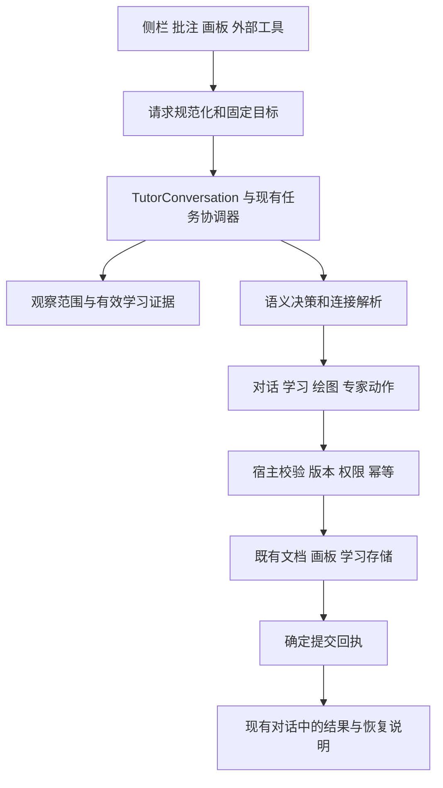

# Tutor 全面优化与商业试点规范

版本：草案 1.0。日期：2026年10月2日。实施更新：2026年10月9日已启动 S0 与 S1 首批优化；S1 整体门槛尚未通过，正式库未替换。具体修复、测试证据及未通过项见[首批实施与验证报告](qa/commercial-optimization-20261009/report.md)。本文其余要求仍是待逐项验收的规范，不表示全部已经实现。

本规范依据[商业化准备度评估](/Users/mac/Tutor/docs/qa/commercial-readiness-20261002/report.md)，将 Tutor 现有的对话、批注、翻译、学习、画板和 Agent 协作收敛为可靠的桌面产品。目标是先达到限定范围的成人付费试点条件，再根据真实使用结果决定正式发布范围。

当前基线为源码 0.5.3，139 个测试文件、1316 项测试通过。Documents 与 Tutor-Acceptance 同为 0.5.3，但构建不同；其程序清单虽各自一致，均不能直接视作本规范的稳定发布候选。当前主要问题是跨入口规则和持久化结果不一致，优化以复用现有实现、统一契约和完成真实流程为主。

**1 产品目标和范围**

对外核心价值为：大学及成人学习者围绕自己的材料提问、批注、共画，并在需要时保存、继续和纠正学习进度。陪伴通过准确记忆、具体鼓励、尊重选择和稳定完成任务体现。

| 类别 | 本轮要求 |
|---|---|
| 默认交互 | 现有侧栏一个主要对话入口；解释、练习、提示、完整答案、暂停、继续和纠正均可自然表达 |
| 界面 | 不新增教学按钮行、选择卡或常驻学习面板。保留必要的画笔、停止、撤销、权限与修改预览操作；详情进入现有更多或设置 |
| 支持范围 | 桌面 Obsidian；先以实际验收的 macOS、具体 Obsidian 版本、Direct API 模型为试点范围，本机 Codex 和 Excalidraw按独立能力验收 |
| 学科 | 首批继续使用极限与连续六主题及既有54模板；不借本轮扩建通用课程平台 |
| 本地能力 | 断网时阅读、手写、编辑、保存、撤销、查看既有成果继续可用 |
| 兼容性 | 保留旧画板、原墨ID、角色版本、批注、v1/v2学习文件和有效连接。无批量重画、重写历史证据或自动更换模型 |
| 陪伴 | 普通对话即可获得成人日常支持；不要求先进入“不保存的对话”，不自动打开签到，不推断人格或心理状态 |
| 协作 | 保留既有MCP/A2A任务基础，优先本机Tutor与Codex。外部读取学习证据和修改对象仍需对应授权 |
| 本轮不扩展 | Android与iPad、远程或三Agent正式承诺、复杂人物质量升级、新图像服务、专业心理服务、学校管理平台、支付与账号平台 |

这些范围限制不删除已有实验能力；通过能力开关和兼容说明区分可用、受限、未验证和不支持。用户的供应商与授权设置保持原意，安全迁移例外须明确说明。

**2 不可降低的行为约束**

| 编号 | 必须保持的约束 |
|---|---|
| C01 固定目标 | 每次请求绑定来源和目标身份。活动窗口改变不能改变写入目标，路径只是可更新的定位信息 |
| C02 权限最小化 | 用户或客户端只能读取和修改授权范围；版本变化、客户端撤销、对象新增不自动扩大授权 |
| C03 结果真实 | “已保存”“已完成”“已核验”分别由持久化回执、任务终态和有效核验产物驱动，模型自然语言不能决定这些状态 |
| C04 一次提交 | 重复点击、网络重试和断线恢复不会重复创建对象、计分或增加学习证据 |
| C05 取消有边界 | 提交点前取消不产生正式修改；提交点后准确报告已提交结果，不谎称全部取消。晚到生成不再提交 |
| C06 原成果保护 | 失败只处理本轮草稿，不覆盖学生并发修改，不删除已有笔迹、资产或学习成果 |
| C07 证据一致 | 所有入口从同一有效证据投影生成上下文；纠正、删除和撤权立即阻止后续引用 |
| C08 私人内容隔离 | 自动学习记录使用受限数学结构；私人困扰、支持摘要及无关聊天不自动进入学习摘要或专家材料 |
| C09 自主学习 | 普通问题正常回答；邀请最多一次；忽略或拒绝不算同意。显示过答案后，同题不能记作无提示完成 |
| C10 发布可复核 | 一个发布版本对应一个冻结源码和安装产物；验收后文件变化即产生新候选，不沿用旧通过结论 |

少按钮原则不取消必要的权限选择和不可逆删除确认。同一已授权工作流不增加逐笔、逐题或逐轮审批。

**3 统一执行架构**

复用 `TutorConversation`、`TutorTaskCoordinator`、`SurfaceAdapter`、`ChangeSet`、`LearningDialogue` 和现有存储。新增接口用于明确边界，不另建第二套任务、聊天或画板提交系统。



`main.ts` 保留服务组装职责。优先提取共享的请求、目标、提交回执和证据投影逻辑，不为文件行数而进行无关重构。

拟议接口示意，实施时与现有类型合并：

```ts
type TurnRequest = {
  requestId: string;
  conversationId: string;
  entry: "sidebar" | "annotation" | "board" | "external";
  kind: "conversation" | "document-edit" | "drawing" | "expert";
  userText: string;
  executionMode: "ask" | "plan" | "build";
  target?: TargetSnapshot;
  observation: ObservationContext;
  learning?: { episodeId?: string; questionId?: string; revision?: string };
  grantRef?: string;
  instruction?: { purpose: "document-edit" | "drawing" | "expert"; text: string };
};

type TargetSnapshot = {
  vaultId: string;
  documentId: string;
  pathAtCapture: string;
  bufferRevision: string;
  diskRevision: string;
  viewId?: string;
  windowId?: string;
  selection?: { from: number; to: number; exact: string; before: string; after: string };
};

type CommitReceipt = {
  transactionId: string;
  requestId: string;
  clientId: string;
  targetId: string;
  baseRevision: string;
  committedRevision?: string;
  createdIds: string[];
  updatedIds: string[];
  deletedIds: string[];
  operationDigest: string;
  durability: "not-applied" | "applied-not-durable" | "committed" | "outcome-unknown";
};

type RecordReadResult<T> = {
  records: T[];
  integrityIssues: { recordId?: string; category: string; recovered: boolean }[];
  completeness: "complete" | "partial" | "unavailable";
  revision: string;
};
```

上述范围、权限与身份字段由宿主赋值或验证，不接受模型自行宣称。既有调用方通过一次性适配进入该契约；`engineText`可暂用于兼容传输，但不得继续承载“是否启用学习”的隐含含义。旧调用无法明确目标或权限时返回受限状态，不能自行扩大能力。

**4 请求入口与完成状态**

需求 R01，对应评估 P1 01。

- 侧栏、批注和画板的普通对话都使用 `kind=conversation`。是否有附加提示词不影响学习控制资格；明确文档修改和绘图才进入相应动作。
- 学习方式与“提问／规划／构建”执行模式分别建模。普通对话中可自然练习；文档编辑回复不能误记为学生作答。
- 绘图继续先经过语义识别，再打开目标画板并执行；不得以单一关键词直接调用生图或改文件。复用当前语义决策，不为所有普通问答增加固定第二次模型调用。
- 普通回复流式显示。结构化学习动作、图形和文档修改只在校验后执行，协议不出现在正文中。
- 区分接收、分析、生成、校验、保存、完成、失败、已取消和待核对；用户默认看到一条简短状态，构建号和路由详情在现有更多中查看。
- 实际模型由统一连接解析器提供。独立画板连接与侧栏不同时，在本次任务说明；不宣称所有能力无条件共用模型，不静默切换供应商。
- 零输出、服务拒绝、格式错误、几何错误、保存错误和目标冲突继续分开处理。鉴权或额度失败不进入格式纠正；有内容但无效时最多一次纠正。模型声明“已画好”不产生成功状态。
- 本地接收后200ms内显示反馈。该目标不等同首个模型token或首图时延；三项分别记录。

验收 A01：从实际 `ChatView.send` 参数经过完整运行器触发邀请，接受后产生一条记录；正文为普通解释时不评分。必须保留一条真实发送按钮的模型验收，不能仅直接调用 `runTutorConversation`。

**5 文档修改与翻译共用目标保护**

需求 R02和R03，对应评估 P1 02及翻译缓存问题。

1. 请求开始捕获文件身份、缓冲版本、磁盘版本和具体选区，复用已有 `text-target`。文件重命名更新身份注册表中的路径；不向用户正文批量插入身份字段。
2. 应用时定位原目标。切到其他文件只改变展示，不改写新文件；原文件关闭后仍须按身份核对。文件被删除、重建或身份无法确认时保留建议，不自动新建替代目标。
3. CM事务可映射范围；原选区或上下文发生变化时重新校验。禁止退回全文第一处 `indexOf`；只能使用身份和上下文唯一定位，歧义返回冲突。
4. 同文档分栏未保存缓冲不一致时，明确使用原捕获缓冲；无法确认哪个是权威版本则停止自动应用。不能直接写磁盘覆盖其他视图的未保存内容。
5. 一次应用形成一次可撤销编辑；回执包含目标和修订。多次点击或响应重发只得到同一结果。
6. 翻译缓存键至少含文档身份、原文hash、源语言、目标语言、词汇/段落模式、提示词版本、供应商与模型配置摘要。摘要不含密钥。设置变化使不匹配缓存失效；在途结果仍属于原语言和原来源，不进入新配置缓存。
7. 重命名不复制或混淆缓存；外部修改、删除与目录切换失效相应项。失败保留译文供放置，不悄悄改其他文本。

验收 A02分为两部分：A02a核对同叶切文件、重复段落、前文插入、选区删除、用户并发修改、重命名、关闭重开、分栏不同缓冲和连续点击的目标保护；A02b核对翻译语言、模式、配置和请求期间中译日切换的缓存及应用。逐项核对文件及缓冲差异，正文未授权修改为零。

**6 图形提交回执与对象授权**

需求 R04，对应评估 P1 03。

- `SurfaceAdapter`增加提交回执能力。宿主在编译草稿时确定所有新增ID，包括自动生成的标签、连接线和附属对象；保存后不能从整个最新场景做差集推断作者或所有权。
- 所有权独立记录 `clientId/transactionId/objectId`；`createdBy=tutor`仅是显示作者，不能证明当前外部客户端有权编辑。历史对象没有可靠来源时保持未授权，用户明确选择后才开放对应修改。
- 复用每目标提交队列。在队列内复查目标修订、对象修订、客户端授权、撤销状态及依赖资产。人类落笔仍可在活动层即时呈现，正式提交按修订序列排队，不用旧场景整份覆盖用户新笔迹。
- 先校验整组和资产，再推进正式提交；一次Tutor回应保持一个撤销单位。图形分组、事务身份和客户端所有权分别管理。
- 幂等键限定于客户端、目标和操作摘要。同ID不同内容拒绝；相同请求断线重试返回已记录回执，不再新增对象。
- 回执清理不能令旧请求变成新的可执行请求。超过保留期的旧请求应拒绝自动重放并要求核对，保留有界的过期屏障；新任务使用新身份。具体期限在S1冻结并写入协议。
- 回执及所有权必须可在重载后恢复。无需保存用户正文或截图；只存确定的ID、版本、状态和摘要。
- 明确定义每个后端的提交点。文档画板与Studio通过保存序列和提交日志保证恢复；Excalidraw若需先应用原生修改再保存，必须暴露真实的持久化状态，不能假称跨文件强原子。
- Excalidraw的同步公开场景更新是应用点，保存成功才是持久确认点。两者之间取消返回 `applied-not-durable`，不能宣称未修改。回执在本次应用时固定精确ID、对象修订和操作摘要，不读取 `await save` 后最新全场景作为本次交易结果。原生修改、撤销与自动保存不受Tutor队列控制；保存前后需核对本次差异，无法确认时返回待核对并停止自动重发。
- 保存失败为 `applied-not-durable` 时不播报已保存，也不能自动重新生成相同对象。保留本轮精确差异并重试保存；回退只能作用于本次未被后续修改的差异，不得覆盖后来的人类修改。
- 结果未知先读取事务日志和目标修订核对。不可确定时保持待核对；停止自动付费重试。
- 提交点前取消丢弃草稿；点后保留已提交作品并返回回执。撤销客户端不自动删除其此前合法作品。

验收 A03：保存期间新增人类笔迹、双客户端交错、ID碰撞、编译附属元素、取消的各阶段、磁盘满、保存完成后断线、重载后重试及过期请求。Excalidraw额外覆盖应用后立即原生撤销或修改再保存。画面、磁盘、撤销栈、任务终态和所有权五者一致；用户后续操作造成的差异须能解释，不能误认成Tutor本次新增。

旧工具响应可继续返回既有场景字段；内部必须经过新提交逻辑。新增回执字段需能力协商，不能要求旧客户端获得新权限才能继续只读。

**7 存储隔离与可恢复记忆**

需求 R05，对应评估 P1 04。

- v1/v2列表读取改为逐条处理，返回有效记录、完整性问题和修订。单个无备份坏文件不会令无关对话失败；整个目录不可读与单条损坏分别报告。
- 损坏、过大、身份不匹配、交叉引用错误和未知新格式分别识别。未知格式视为不支持，不能直接当损坏后回写旧结构。
- 可用 `.previous`恢复时核对身份和删除屏障，保存原异常文件并使用比较写入；读取与修复之间原文件已变化则放弃恢复，不能盖掉用户外部修复。
- 无有效备份时保留原文件并隔离其索引，不删除成果。恢复动作不得用模型猜出“原来的学习记录”。
- 无关来源坏记录只在诊断中出现一次；当前相关证据缺失时向Tutor传递 `partial/unavailable`，禁止把它等同“从未学习过”或补编记忆。
- 普通问答可继续使用用户本次材料；相关记录无法可靠写入时明确“本次解释可继续，进度暂未保存”，不宣称已记住。
- 所有引用经过同一投影服务。新增、纠正、删除、修复、外部修改和撤权都使相关缓存及在途上下文失效。失效粒度按来源和证据修订，避免其他文档的正常记录变化不断中断当前对话。
- 诊断默认只含本地问题ID、错误类别和数量；导出默认去掉文件名、路径、正文与答案。

验收 A04：首次保存中断无备份、备份也损坏、错ID、重复ID、被删除记录有旧备份、目录权限失败、外部修复竞态、无关来源损坏。正常记录和本地绘图保持可用，坏证据不进入能力判断。

**8 自然学习状态与证据修复**

需求 R06至R10，对应入口、纠正、续题、答题格式与帮助误记。

学习会话使用明确状态；邀请是临时状态，不等于持久化学习事件：

| 状态 | 可执行转换 | 约束 |
|---|---|---|
| 普通对话 | 邀请、直接回答 | 未同意不建立学习事件，普通问答不评分 |
| 待同意邀请 | 接受、拒绝、失效 | 具有稳定invitationId、拟用questionInstanceId、邀请轮次，绑定会话、来源和概念；短“好的”只对仍有效的对应邀请生效 |
| 活动题 | 作答、提示、答案、暂停、换题、纠正 | 每个动作有题目ID、请求ID和期望修订；含糊或非作答内容不记错 |
| 暂停 | 继续原题、明确换题 | 继续不创建新完成次数，不因跨窗口切换丢失原题 |
| 本轮完成 | 调整检查日期、请求新题、开始到期检查 | 未来检查未到期时不自动换题；不使用连续打卡压力 |
| 到期检查活动中 | 继续当前检查、作答、暂停 | 启动检查只消费一次到期任务；再次继续保持未答题ID |
| 已删除或证据不可用 | 普通对话、显式恢复处理 | 晚到响应不得复活记录；不自动新建一份绕过删除 |

**邀请与恢复。** 忽略、拒绝、转话题或来源变化结束待同意邀请。重启不恢复短句即可接受的旧邀请；活动事件保留，重新进入时按明确来源或用户请求恢复。多个候选无法可靠区分时用一句自然语言澄清，不猜测或新增选择面板。接受仅授权本事件，不开启签到、不扩大专家权限。

接受以 `invitationId` 原子消费并保存消费回执；两个窗口使用不同请求ID接受同一邀请，仍返回同一学习事件和题目。状态转换、对应证据与去重回执按同一恢复协议提交，不允许“已消费却找不到事件”。外部Agent不能代替学习者同意、作答或修改学习证据；学习上下文读取授权不含写入权，本地学习者的明确操作才可触发相应记录。

**受限答案提取。** 使用同一轮模型返回候选答案跨度或宿主确定性解析，不固定增加一次模型调用。宿主验证跨度来自当前输入，并按题型解析裸数、“答案是9”、有限小数、科学记数、Unicode负号、受限分数与选择题语义ID。分数用有界整数或有理数求值，限制长度、分母和复杂度，不执行模型代码。单位只按题目声明的有限单位表处理；没有规则时保留待澄清，不能随意删单位。多个互斥答案、推导中的中间值、引用别人答案或“可能9也可能10”不能直接评分。容差由题目规范给出，不由模型临时决定。

**纠正。** 纠正记录引用原证据和原题ID，立即使原判断失效。所有prompt与MCP投影使用同一有效证据集合，不再直接发原始证据尾部。质疑不自动变成另一个“正确”结果；需要重验的题显示为未核实。连续纠正、删除纠正或跨题纠正均保留可追溯关系，不重复计为完成。

依赖原证据的掌握汇总、复习阶段、待执行检查与专家结论同时失效或标为待重验，并重新计算有效调度。后来独立取得的成果保留，不能一并删除；哪些结论依赖被纠正记录必须可追溯。删除或撤销纠正不未经重验复活旧成功。

**提示与答案暴露。** `HelpExposure`绑定题目、回复/图形事务、请求、类型和呈现状态，记录宿主能够观察的“已经提供或可见呈现”，不证明用户实际阅读。相关帮助的流式展示前建立准备记录，呈现后确认；中途崩溃或确认不明时独立性为 `unknown`，不恢复无提示资格。帮助事实与答题提交分别有提交点，取消整轮或撤销评分不能抹去已提供的提示、答案。问快捷键、问候和无关聊天不增加提示数。相关自由解释可能揭示答案但无法确定程度时也标为未知，不能一律记成提示，也不能宣称无帮助完成。

**延迟检查。** 用独立的到期任务身份和消费状态绑定当前题，原子地建立题目并消费到期任务。重复继续只恢复同一题。延迟题与练习、迁移题池保持分开；按既有1/3/7天规则安排，失败后提供帮助并下一天再试。时区和日期变化不得重复消费；记录绝对时间及用于安排的本地日期。每日预算默认20分钟、允许调整并明确为估算，不将次数乘固定分钟数包装成精确学习时间。

**掌握程度。** 自评、提示后完成、未使用插件提示、迁移和延迟验证保持区别。无提示只说明插件内未展示帮助，不证明没有其他帮助。54模板仍是限定主题练习；自由解释反馈显示为Tutor判断，学生可以纠正。

验收 A05：实际入口的邀请/忽略/拒绝/接受、不同请求ID并发接受同一邀请、外部代理接受被拒、答案提取边界、错误纠正关联、无关聊天、答案展示中取消/崩溃/撤销评分、到期重复继续、时区变化、切文档与重启。额外覆盖纠正早期成功时已经完成后续迁移或延迟检查的依赖链。每项检查题ID、证据ID、帮助标记、调度状态和最终回复。

**9 私人内容隔离和可信陪伴**

需求 R11，对应评估 P1 05。本节是数据流与产品行为规范，不以增加敏感关键词表作为完成条件。

| 数据 | 默认处理 | 外部共享 |
|---|---|---|
| 普通聊天原文 | 沿用用户现有保存选择；不因出现困扰偷偷改变历史保存设置 | 不自动作为学习摘要或专家历史 |
| 数值与选择题证据 | 存宿主规范化答案、题ID、判题结果和帮助事件 | 仅按独立学习证据授权及文档范围投影 |
| 自由解释反馈 | 当前对话可自然显示；自动证据只存数学题库限定的判据ID、状态、模型判断来源和待验证事项 | 不复制用户或模型自由文本进入自动摘要 |
| 用户明确要求保存的解题原文 | 作为独立、可删除的本地学习材料，清楚说明保存位置；不作为默认自动证据字段 | 不随学习证据授权自动开放；本次明确选中并授权才可提供 |
| 支持对话和关怀摘要 | 现有临时选项与私有加密摘要继续独立；可查看、删除和到期 | 不提供给专家、MCP学习工具、角色设定或普通诊断 |

自动记录结构不得含任意 `attempt/feedback/notes`自由文本通道或可任意填入内容的扩展字段。允许的数学结构由Zod和宿主题库限定，模型只能提供候选；字符串数值、概念枚举与判据ID须验证。模型误把私人困扰分类成解释时，也没有可持久化这段原文的自动字段。

限制同时适用于新记录的上一修订、冲突副本、提交日志及诊断，不能在主文件写入前先把原始回复落到中间文件。旧记录的保留或人工恢复副本仍按原文件权限管理，不伪称已完成历史私人文本清除。

旧v1/v2的自由文本不批量删除，但不能继续未经区分地进入新版共享摘要。宿主可从可验证的旧题记录提取规范数值或选择结果；不能安全投影的记录标为旧的未验证记录，仅保留本地查看，不用模型“清洗”后假称无敏感内容。

私人内容仍可能出现在用户已选择保存的普通聊天中；本规范不宣称整个Vault没有私人文本。目标是阻止其自动变为学习证据或专家材料。支持内容删除后，撤销相关缓存和在途请求，常规导出不包括私有摘要。

陪伴回应应引用可追溯事实；无记录时承认不知道，用户纠正时不编造旧经历。允许直接解答和休息，不以离开负担、排他关系或要求回来汇报制造陪伴感。对困扰先回应其需要，必要时暂停练习；不自动记录心理、人格或能力标签，不自行联系他人。

沿用20个单轮与8组多轮成人合成评测，补充混合数学与困扰、删除记忆后续聊、无历史被询问、拒绝建议和跨日纠正。对正式支持的实际模型逐一评审；严重风险回应、隐私或排他依赖失败单独判定，不能被平均分抵消。专业审查、未成年人和长期效果继续未通过。

验收 A06：故意给出错误 `explain` 动作和含私人内容的候选，记录及MCP结果均不得含原文；新旧证据共享路径、删除、撤回、导出、诊断、专家材料全部检查。解释原文没有自动保存时，界面不能声称以后能逐字记得。

**10 画板排版与桌面交互**

需求 R12。先修真实阅读裁切，再收敛跨模式行为，不借机扩大专业绘画范围。

- 工具栏占位和文档可用宽度使用同一几何计算；禁止仅增加margin却保留宿主旧宽度。布局必须核对clientWidth、scrollWidth、滚动容器和Obsidian内联样式，不预先认定单条CSS就是唯一根因。
- 新生成独立图先寻找可见空白，整组等比放置；文字小于可读阈值时不硬挤。空间不足由Tutor用一句话解释并征求改到Studio的选择，不静默换目标。
- 新图落位与后续图上批注分开。学生在图上写字、圈线或加文本不令原图隐藏、不触发重新排位；手动摆放不被自动布局覆盖。
- 原文或媒体真正重排时，重新测量锚点，保留图形身份、形状和局部坐标。不能定位时保留数据并说明受限；已可见作品不因普通笔迹相交被当成无效对象。重定位仅在必要时提供一次自然语言提示，既有查看和撤销入口继续可用。
- 本轮不自动将图与所有后加批注绑定为一组。用户整体移动需求沿用明确选择/分组，避免隐藏地改变编辑语义。
- 阅读状态保留选字；画笔状态接管指针。IME组合输入期间不截图、不自动抢焦点；工具切换等组合输入结束后执行，不强制打断中文输入。
- 隐藏侧栏时，当前Tutor回复按既有画板呈现方式显示；重新打开侧栏继续同一请求，不重复调用模型或多存一份学习结果。
- 弹出窗口使用所属窗口的字体、设备像素比和坐标转换；关闭视图释放显示资源，不删除画板。
- 可选文字PDF与扫描PDF分别验收。没有可靠正文或截图时说明实际观察范围，不假称看过整页；保留四种旋转、缩放、滚动和页面重挂载的坐标测试。
- 源码、实时预览、阅读三种模式不能要求拥有相同像素尺寸；要求锚定关系正确、图形不变形、正文不裁切、不写错文件。

验收 A07：重复本轮Commercial QA，分别开启/隐藏画板、切阅读/实时预览/源码；再覆盖窄分栏、弹出窗口、图片加载、表格公式重排、中文输入与图上批注。新图数据与截图共同检查。

**11 作画性能和结果质量**

需求 R13。保留现有活动笔迹独立绘制、缓存和分帧首绘；性能改动必须维持视觉一致性。

| 场景 | 拟议目标与测量方式 |
|---|---|
| 本地接收、停止、工具切换 | 200ms内可见反馈；不以文案出现替代首个有效图形或完成时间 |
| 参考桌面1000对象混合笔迹 | 活动笔触应用渲染p95不超过16.7ms，同时报告p99、最大值和丢帧；另测真实笔尖延迟 |
| 冷启动与5000对象/50万点 | 分别记录首次有效可见画面、全图完成、单帧工作和峰值内存；普通可见首批内容目标500ms内；单次分块尽量控制在8ms预算内 |
| 复杂图层、裁切、透明度、外部图片 | 不通过跳过效果伪造流畅；不能安全分帧时说明受限，保持输入与停止可响应；未过前不宣传全部负载流畅 |
| 持续使用 | 2小时交替绘画、缩放、撤销、切文档及保存；无持续资源增长、崩溃或丢笔。空闲后缓存回到配置上限，报告剩余内存而非仅给“通过” |

上述是本项目拟议门槛，不是当前成绩或行业认证。测量前封存参考设备CPU、内存、系统、Obsidian、DPI、窗口尺寸、笔设备、场景hash和缓存状态。冷场景与热缓存至少各重复运行，保存原始分位数、长任务和失败样本；不能只测空闲帧。

优化顺序为可见区裁剪、稳定缓存键、有界位图缓存、增量失效、分块或Worker计算、必要时图层瓦片化。禁止在pointermove中扫描和重绘整幅场景。缓存变化用固定种子和像素/对象对照验证，原墨不重新生成。

数学图仍由受限MathPlotSpec统一计算；固定用例覆盖x²、sin(x)/x、(exp(x)-1)/x、可去间断、跳跃和1/x，同时核对标记、断开、轴变换与正文位置。复杂人物继续实验标记，本轮不以增加笔触数作为视觉质量提升，也不把动画称为真实画师笔顺。

验收 A08：自动性能脚本与真实笔操作并行；失败保持明确受限范围。Excalidraw运行时的性能单独记录，不混入Tutor自有渲染器成绩。

**12 外部工具和本机专家**

需求 R14和R15，对应MCP授权、Clipper配对与取消问题。

MCP/A2A继续使用现有任务、授权与提交层。普通问答保持单Agent；专家收到当前任务所需材料和安全学习摘要，不获取完整历史或支持数据。目标、来源修订和已选图形在启动时固定；失败、取消和过期结果不标记已核验。已经完成的结果重载可恢复，中断任务标为中断，不自动重新付费调用。

Clipper采用明确配对流程：

1. 浏览器提出配对请求，仅创建短时挑战；Origin、扩展名称和固定header都不提供权限。
2. Obsidian通过现有权限流程显示客户端、请求能力和目标目录，由用户确认；挑战默认5分钟到期、一次消费，防重放并限制频率。
3. 成功后给客户端独立随机令牌；宿主存哈希及授权，浏览器存本机非同步区域。capture与ask分开，首次或扩大权限需明确选择。
4. 凭证不能授权任意Vault、文档或其他客户端句柄。loopback、Host、Origin和负载限制继续保留，作为纵深检查而不是身份认证替代。
5. 旧共享token不能自动转换成被信任的客户端；升级后旧Clipper需重新配对。未完成迁移时该服务关闭，本地学习不受影响。
6. 关闭页面、HTTP断开、用户停止和撤销权限统一触发AbortSignal，向Direct API或ACP取消传播。客户端重连先查询状态，不自动重发付费任务。
7. 默认每客户端最多1个生成任务、每库最多2个外部生成任务；排队可取消，重试总量沿用任务预算。上限是本轮保守默认，经过负载验收再调整。

取消不能保证供应商退还已产生费用。界面说明停止本地等待和已发送的取消状态，不承诺“零费用”。服务拒绝、预算耗尽和未知结果分别处理。

验收 A09：正式MCP客户端和实际本机Codex/Tutor正向、取消、部分失败、重载恢复；未知扩展、伪造名称、挑战过期与重放、跨客户端句柄、授权撤回和断连。未具备可用OpenCode模型或远程服务时单列阻塞，不用模拟成功替代。

**13 凭据与受管理回退**

需求 R16。设置改为凭据引用；复用现有桌面私有存储边界，优先使用可用系统安全存储。各平台实现能力必须检测，不硬编码仅适用于macOS的假设。

- 迁移顺序为写入安全存储、读取一致性验证、原子保存引用、移除当前配置的明文字段。任何步骤失败不得丢失既有连接；明确标记未迁移，保留原配置供用户处理，不能报告已完成。
- 新增配置在系统存储不可用时可只驻留当前会话；不静默明文降级。不强制切换供应商或把其他宿主的凭据复制过来。
- 迁移完的当前设置、常规诊断和发布包不含密钥。历史配置备份可能仍有旧明文，须说明位置和由用户处理的选项，不能宣称迁移能远程清除同步历史。
- 私有支持摘要不随源码或发布备份复制；凭据服务与摘要服务可复用加密设施，但权限与数据目录分别管理。

受管理回退使用独立恢复工具：暂停入口、等待保存、停止本插件在途任务和所属服务、停用插件、验证旧包、切换、核对、启动健康检查。保存失败时，必须先完整封存内存草稿及依赖资产并验证可恢复；无法封存则阻止自动卸载和回退。只有用户明确选择放弃具体未保存内容才可例外继续，常规升级授权不包含这一选择。未知用户文件不删除，当前笔迹、批注、学习记录和凭据引用保留。

回退到不理解新安全边界的旧版本时，恢复工具必须先关闭旧Clipper/MCP联网开关并清除全部旧共享token，禁止整份覆盖旧 `data.json`。新的客户端授权与撤销清单保留，重新升级不复活旧授权。保留系统中的新凭据；旧程序不能读取引用时只保留本地功能，重新升级后恢复连接，不自动复制回明文。

旧0.4.6和当前0.5.3可作历史数据兼容检查，但不能因为“以前用过”就标为安全稳定回退包。首个通过本规范数据与权限门槛的候选才成为新的受支持基线。受管理回退可保证上述变换；用户自行覆盖旧程序不在保证范围内，文档明确说明。

验收 A10：系统存储不可用、迁移中断、多供应商、跨设备引用无法解析、旧配置恢复、撤权后降级；确认新成果保留、旧服务未重新开放、重新升级能恢复关联。

**14 数据格式与迁移策略**

不批量转换既有画板或学习文件。当前文档画板、矢量资产和原墨各有自己的格式版本，实施前按真实schema核对；不将旧文档中笼统的“v5”当成所有文件都应写入的版本。

| 新增或调整的数据 | 兼容策略 |
|---|---|
| 目标身份与重命名索引 | 独立版本化宿主清单，引用稳定对象/文档ID；不侵入用户正文 |
| 提交回执与客户端所有权 | 独立v1清单或事务日志；旧作品无来源不自动认领；具备幂等恢复和清理上限 |
| 安全学习证据 | 新的受限记录格式固定独立存放于 `learning/v3`；v1/v2继续读取和只读展示，续学引用旧ID，不复制为新完成次数 |
| 纠正与帮助事件 | 与对应题和来源证据关联，包含版本与幂等键；未知格式不由旧解析器重写 |
| 旧自由解释 | 保留原文件；新版投影不直接共享原文。用户明确保留的解题材料与证据分别管理 |
| 连接配置 | 密钥变引用；路由、模型和用户偏好保持；旧外部配对不获得更多权限 |

本轮受限证据与既有自由文本记录职责不同，使用学习v3，不修改旧v2语义假装兼容。S1开始新记录写入前必须冻结Zod schema、目录、最大容量、上一修订、删除屏障、比较写入、外部修改和恢复策略，并通过v1/v2/v3共存测试。新格式未完成时关闭不安全的自由解释自动记录，保留当前对话反馈并准确说明进度未保存。降级后新记录可以暂不可见，但不得损坏；重新升级仍可按原ID继续。

不能在旧客户端继续写回的同一文件里增加安全关键字段后期待它保留这些字段。需要跨版本保护的身份、隐私和授权使用独立清单，旧写入发生时新版根据修订重新验证，不能盲信旧回执。

**15 发布产物和诊断**

需求 R17。构建与安装有单一负责人和互斥锁，不允许并行任务向同一正式库自由部署。

`ReleaseManifest`至少记录产品版本、构建ID、冻结源码树hash、锁文件hash、Node/pnpm版本、文件hash清单、数据读写兼容范围、安全配置版本、功能状态、验证报告及恢复包。只构建一次，测试库验收、正式安装和发布使用同一个产物；验收后改动文件必须重建新候选。

CI继续类型检查、全量测试与构建，并增加最终包完整性、发布allowlist、凭据扫描、许可证检查、安装事务故障测试及恢复兼容。真实模型、GUI和设备验收独立记录，不让CI绿灯自动替代。

发布说明统一入口，更新README、manifest描述、安装、首次使用、数据流、费用、已知问题、兼容矩阵和恢复指引。历史QA保留并标明适用构建，不能覆盖成当前全部通过。安装文件以封存包清单为准，不维护容易过期的固定文件数量。

诊断默认只记录请求ID、路由、阶段、耗时、状态、输出长度、对象数量、版本和错误类别；不含正文、截图、答案、密钥或内部推理。日志有容量和期限，本地可清理；导出需用户主动触发并预览去敏范围。不新增默认上传遥测。

**16 实施批次和依赖**

S编号为实施顺序，不是已经发布的版本。产品版本在每批冻结时统一分配，不提前改manifest宣称完成。每批独立封存产物和验证报告，未达到其门槛不进入当前库安装。

| 批次 | 范围与主要落点 | 出口条件 |
|---|---|---|
| S0 基线与发布隔离 | 封存当前源码/锁文件/环境，分别封存两个实际安装；私有备份配置与数据；建立构建安装锁 | 测试库在关闭外部服务的隔离条件下完成基础文件恢复与新成果保留演练；完整安全回退在S1验收。不称旧基线已修复 |
| S1 数据和权限保护 | R02/R04/R05/R11基础隔离/R14配对/R15取消/R16；`text-target`、通用编辑、surface、MCP、store、web-bridge、凭据和恢复工具；先冻结v3受限schema与旧记录投影 | A02a/A03/A04/A06隔离部分/A09权限与取消部分/A10通过。未完成的外部服务关闭；核心本地操作可用 |
| S2 自然学习闭环 | R01/R06至R11；`chat-view`、conversation、learning-dialogue/context/store、题库和教学策略；使用S1冻结的受限证据格式 | A01/A05/A06通过；真实侧栏到保存重开闭环；无新增教学按钮；修正、提示和到期题身份一致 |
| S3 桌面交互与性能 | R03/R12/R13；翻译缓存、board controller/surfaces/editor、styles、渲染与缓存 | A02b/A07/A08及A02a回归通过；正文无裁切，图上批注不隐图；性能限制如实记录 |
| S4 跨入口与支持验收 | 对话/批注/画板/正式MCP、Direct API和本机Codex；成人支持多轮，Excalidraw目标保存和撤销 | 对外承诺的组合全部完成；部分失败、停止、恢复及隐私门槛通过；不可用模型列阻塞 |
| S5 交付与限定试点 | R17、当前文档、新手任务、小样本研究、支持和费用说明 | 同一冻结产物完成安装和回退；研究发现的关键阻塞修复后复测，再决定试点或正式发布 |

S0先行；S1的数据与权限契约确定后才能实现S2的持久化和外部读取。S3可在契约冻结后并行开发，但合并验收依序执行。S4/S5不能跳过失败的基础门槛。实施任务可以分工，源文件与正式安装必须有明确写入边界。

需求追踪如下。每个实施任务、回归用例和发布报告引用对应R/A编号，避免“整个学习模块完成”掩盖单项缺陷：

| 需求 | 可交付结果 | 实施批次 | 主要验收 |
|---|---|---|---|
| R01 | 实际侧栏及其他入口进入相同对话和学习规则 | S2 | A01、A05 |
| R02 | 文档编辑绑定身份、选区和版本 | S1 | A02a |
| R03 | 翻译缓存与语言、模式、来源一致 | S3 | A02b |
| R04 | 精确提交回执、幂等和对象所有权 | S1 | A03 |
| R05 | 单记录损坏隔离和可信恢复 | S1 | A04 |
| R06 | 邀请原子消费、授权与活动题恢复 | S2 | A01、A05 |
| R07 | 自然答案受限解析与确定性判题 | S2 | A05 |
| R08 | 纠正关联及依赖结论失效 | S2 | A05、A06 |
| R09 | 帮助暴露与评分分别记录 | S2 | A05 |
| R10 | 到期检查只创建一次且续学一致 | S2 | A05 |
| R11 | 受限证据、私人内容隔离与支持边界 | S1建数据边界，S2接流程，S4实测 | A06 |
| R12 | 正文不裁切、图上批注不隐藏、窗口输入正确 | S3 | A07 |
| R13 | 冷启动、活动笔迹、持续负载与数学图质量 | S3 | A08 |
| R14 | 客户端配对、授权隔离与最小专家材料 | S1基础，S4实测 | A03、A06、A09 |
| R15 | 断连取消、任务恢复与重复调用保护 | S1基础，S4实测 | A03、A09 |
| R16 | 凭据迁移及不丢成果、不恢复旧授权的回退 | S1 | A10 |
| R17 | 冻结构建、包检查、准确文档与诊断 | S0建立隔离，逐批执行，S5交付 | A10、研究记录 |

**17 验收矩阵与通过规则**

| 验收组 | 自动化 | 真实操作或模型 |
|---|---|---|
| A01 入口 | 执行实际ChatView发送方法及完整参数路径，不只调用宿主 | 选材料、直接解释、邀请、同意、保存 |
| A02 编辑翻译 | A02a身份/版本/重复文本/保存竞态；A02b语言/模式/配置与缓存 | 两文件/分栏切换、重命名、译文应用与原生撤销 |
| A03 事务权限 | 并发人类对象、双客户端、回执丢失、保存失败、取消边界 | 一次修改一次撤销、保存重开、正式客户端重试 |
| A04 数据恢复 | 坏主文件/备份/身份/权限、删除屏障、外部修复 | 普通聊天可继续，相关记忆明确受限，恢复后更新 |
| A05 学习 | 54模板边界、自然答案、帮助、纠正、重复续题、跨日 | 同题与新题差异、用户改口、重启继续、不同入口一致 |
| A06 隐私陪伴 | 故意误分类、自由文本注入、旧记录投影、删除和导出 | 20单轮/8多轮实际模型，逐例人工检查，不以平均分遮盖严重失败 |
| A07 桌面 | 几何、锚点、IME状态、字体与窗口生命周期 | 阅读/实时预览/源码、PDF两类、旋转、分栏/弹窗、图上批注 |
| A08 性能质量 | 固定负载、冷/热缓存、长任务、像素或对象差异 | 实际笔输入、2小时会话、数学数据与画面核对 |
| A09 协作 | 客户端隔离、挑战、取消、预算、重连、结果恢复 | 正式MCP、本机Codex/Tutor、Excalidraw实际版本 |
| A10 发布回退 | 故障注入、包hash、安全配置、格式共存、凭据排除 | 测试库升级、新增记录/笔迹、回退、再升级，必要时断网恢复 |

每条记录包含请求ID、代码/包hash、设备、宿主版本、模型/端点类别、前置设置、步骤、期望、实际、证据和限制。截图不含私人资料。模型原始输出仅在合成验收且确有需要时保存在独立测试产物；不作为默认生产日志。

已有复现脚本是回归种子：[工程复现](/Users/mac/Tutor/docs/qa/commercial-readiness-20261002/engineering-repros.mjs)、[学习复现](/Users/mac/Tutor/docs/qa/commercial-readiness-20261002/learning-repros.mjs)。实施时保留缺陷前后证据，将期望反转为正确行为测试；不能把脚本退出0误当修复通过，因为现版退出0表示缺陷成功复现。

源码的 `pnpm typecheck`、`pnpm test`、`pnpm build` 每批必跑。文档设计本身不要求重跑全量产品测试；实现或包内容变化才触发相应验证。

**18 兼容范围与商业发布决策**

兼容表采用“已验证／已知受限／未验证／不支持”四态，至少列操作系统、Obsidian版本、窗口/DPI、输入设备、三种Markdown模式、两类PDF、分栏与弹窗、模型连接、Codex/OpenCode、Excalidraw和升级路径。当前minAppVersion只是声明；若未验证最低版本，应补测或调整声明，不能以编译成功代替。

Windows/Linux的CI通过不等于真实GUI通过。先发布已实测范围，不将未过的平台从报告中删除；OpenCode或远程服务不可用时保持具体阻塞原因。

| 决策 | 必须满足 |
|---|---|
| 成人封闭试用 | 有人支持、材料有备份、明确预览和受限能力；高风险入口限制使用 |
| 限定付费试点 | 本轮核心P1全部关闭；未纳入范围的高级服务确定关闭。固定用例未授权读写、丢失、重复提交为零；完整学习流程、必要支持边界、冻结包和受管理回退通过 |
| 正式自助发布 | 在试点门槛上，公开承诺的兼容矩阵通过，陌生用户能按说明完成首次收益和错误恢复，文档、支持和商业说明完整 |
| 仍有阻塞 | 任一核心数据/隐私/权限门槛失败，或实际入口流程未通；不得用平均评分或漂亮局部画面抵消 |

商业说明至少明确收费内容、是否包含模型费用、第三方额度影响、支持联系和时段、严重故障处理、支持版本、升级期限、取消与退款安排。具体价格和服务承诺由真实成本及运营能力决定，本spec不预设收益，也不要求本轮搭建支付系统。

**19 真实用户研究**

先招募5至10名成年目标用户，包含Obsidian经验较少者，避免全部为开发者。建议一次45分钟使用观察和3至7天后一次15分钟续学观察；这用于发现可用性问题，不证明长期学习、心理支持或市场转化效果。

任务按中性描述覆盖安装连接、理解材料外发范围、提问与拒绝/接受练习、自然作答、请求提示或答案、教学共画、手动批注、保存重开、跨入口继续、纠正一次记忆和处理一次失败。主持人帮助必须记录，不提前教点击路径。录屏、诊断导出和研究材料再利用分别取得同意；拒绝录屏不影响参加，不默认用于训练。

研究开始前冻结以下项目门槛：

- 数据丢失、未授权上传或修改、取消后新增正式内容等严重事件为零；出现即停止对应任务并修复。
- 至少 `ceil(0.8 × 实际参与人数)` 人无需主持人操作指导完成核心任务；报告写实际人数，如4/5，不外推总体80%成功率。
- 同一关键步骤阻塞两人即进入必须修复清单，不能以平均满意度冲抵。
- 参与者能复述保存范围、外发范围和模型费用；理解错误需要调整默认行为或文案。
- 修复后复测受影响任务，并加入未见过设计的人，减少熟悉效应。
- 记录完成时间、首个有效反馈、模型/工具调用次数、用户重试、人工帮助、恢复结果和退出原因。模型成本能取得可靠usage时单独记录，不从文字长度伪造账单。

研究通过只支持限定试点决策。跨日留存、付费意愿、学习收益和更广泛商业可行性需要独立数据，不能由这组小样本宣布已验证。

**20 开工前需固定的实施信息**

以下不阻碍按本文启动基础修复，但在相应验收前必须写入报告：参考桌面与笔设备、要正式支持的Obsidian版本、实际可用的Direct API/OpenCode/Codex配置、Excalidraw测试版本、试点支持负责人及真实用户招募安排。不得将未知值填成已通过。

第一张实施任务应是S0基线与恢复演练，随后进入S1的数据与权限保护。未完成基础修复之前，不新增课程、人物生图能力或多Agent规模作为商业化进展的替代指标。
